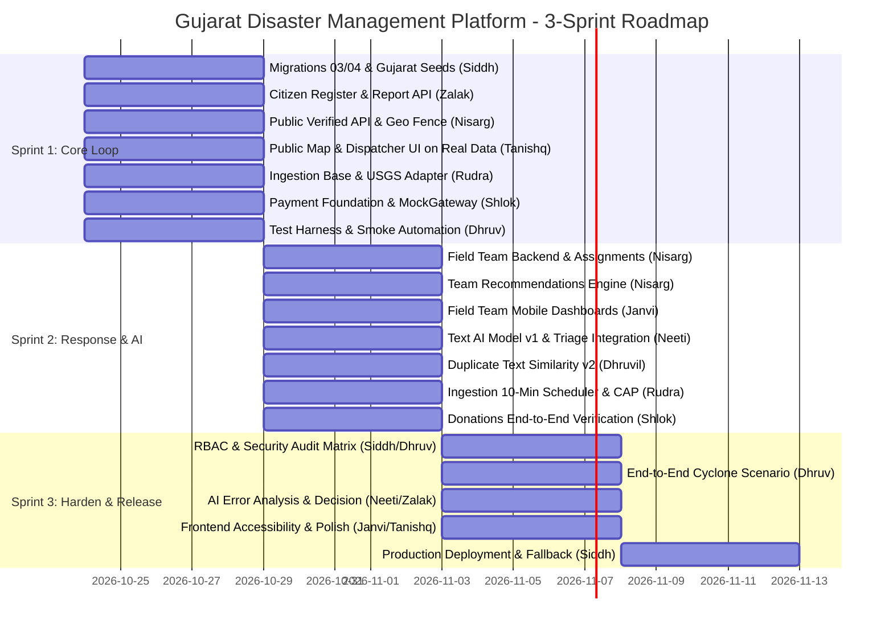

# Gujarat Disaster Management Platform (DRCH)

Disaster Response Coordination Hub — an operational incident coordination
platform built for the State of Gujarat. The system connects three groups of
users: citizens who report emergencies, disaster management staff who triage
and dispatch resources, and field teams who receive assignments and report
progress in the field.

---

## What is real (verified in code)

The following capabilities are implemented end-to-end and covered by
automated tests in `backend/tests/`.

**Staff authentication with mandatory two-factor login.**
Staff accounts require an Argon2id password followed by a TOTP code
(RFC 6238, 30-second window). The MFA challenge is a short-lived,
purpose-bound JWT. A failed code or expired challenge does not issue an
access token. Login failures are counted; after five consecutive failures
the account is locked and all existing tokens are revoked by incrementing
`token_version`. (`backend/app/routers/auth.py`, `backend/app/security.py`)

**Incident verification workflow.**
A dispatcher can move an incident through the states SUBMITTED,
NEEDS_INFORMATION, VERIFIED, REJECTED, DISPATCHED, RESOLVED, and CLOSED.
Each transition is validated by a strict state machine, recorded in
`incident_status_history`, written to the audit log, and triggers a
notification to the reporting citizen. A VERIFIED decision requires a
priority level (CRITICAL, HIGH, MEDIUM, or LOW) and a rationale.
(`backend/app/routers/dm/incidents.py`)

**Resource dispatch with row-level locking.**
When a dispatcher creates a dispatch order, each requested resource row is
locked with `SELECT ... FOR UPDATE` before the available quantity is
decremented. Concurrent requests for the same resource that would
over-allocate are refused with a 409 RESOURCE_CONFLICT response and no
partial state is written. Resources are released automatically when a
dispatch order is rejected or completed.
(`backend/app/services/resources.py`, `backend/app/services/dispatch.py`)

**Append-only, hash-chained audit log.**
Every state change, login event, access denial, and dispatch action writes
a row to `audit_logs`. A PostgreSQL trigger (`fn_audit_log_hash_chain`)
computes a SHA-256 hash of each new row concatenated with the previous
row's hash, storing it in `row_hash`. Database-level triggers also block
UPDATE and DELETE on the table. The CI pipeline verifies the hash chain
on every pull request. (`backend/db/migrations/01_schema.sql`, lines 602-629)

**Gujarat boundary enforcement.**
Incident coordinates are validated against Gujarat state boundaries via
PostGIS spatial queries, with automatic fallback to the Google Maps
Geocoding API (if `GOOGLE_MAPS_API_KEY` is configured) and then to
OpenStreetMap Nominatim (free, no key required). Resolved districts are
cached in the `administrative_boundaries` table.
(`backend/app/geo.py`)

**Advisory AI triage.**
Submitting an incident to the AI triage endpoint returns a suggested
scenario and priority level from an in-process rule-based classifier with
guardrails. The result is advisory only: it is stored separately and never
applied to the incident automatically. A human dispatcher makes the final
verification decision. (`backend/app/services/ai_provider.py`,
`backend/app/routers/dm/ai.py`)

---

## What is simulated

**Demo seed incidents.**
The database seed file inserts four demo incidents across Gujarat with
`is_simulated = TRUE`. These exist only to give reviewers and testers
something to look at on first boot. They are not live reports.
(`backend/db/seeds/seed_data.sql`, section 8)

**Mock payment gateway (SANDBOX).**
The donation campaign data model and API are present, but there is no
live payment gateway integration in the current codebase. Any payment flow
shown in a demo uses simulated sandbox / placeholder responses.

**Fallback fixtures for external alerts.**
No live alert ingestion worker is active (`ai-workers` is an inactive stub).
Alerts shown in demonstrations use fallback database fixtures flagged with
`is_fallback = TRUE`. (`backend/db/migrations/03_core_extensions.sql`)

**Synthetic or replayed social data.**
Social distress signals and external disaster feeds are not ingested live;
any social feed data displayed in the interface is synthetic or replayed.

---

## Staging and cold-start

- Backend API (Render): Configured via `STAGING_URL` or Render web service `https://drch-backend.onrender.com`
- Frontend (Vercel Preview): Deployment preview URL generated via Vercel integration

The backend runs on Render's free tier. Free tier services sleep after a
period of inactivity. The first request after an idle period may take 45 to
90 seconds while the container wakes up, initializes database connection pools,
and completes background worker checks. Cold-start polling and smoke scripts
should use a 90-second timeout.

Health check endpoints:
- Liveness probe: `GET /health` returns `{"status": "healthy", "service": "drch-backend"}`
- Database reachability: `GET /api/v1/health` returns `{"status": "healthy", "service": "drch-backend", "database": "ok"}` when PostGIS is connected, or `"unavailable"` / `"not_configured"` otherwise.

---

## 👥 Team Roster & Ownership Matrix

| Member | Group | Role in Project | Key Module Ownership |
| :--- | :--- | :--- | :--- |
| **Siddh** | **Leader** | Tech Lead & Integration Owner | CI/CD, database migrations (01-04), secrets management, merge gatekeeper, repo hygiene. |
| **Zalak** | Frontend & Backend | Citizen & Public Backend Lead | Citizen auth/register API, incident reporting, timeline, LLM adapter, AI-vs-human analytics. |
| **Nisarg** | Frontend & Backend | Dispatch & Field Backend Lead | Field team role & assignments API, Gujarat geofencing (`geo.py`), team recommendation engine. |
| **Shlok** | Frontend & Backend | Payments & Dispatch Refactor | Payment gateway interface & MockGateway, donation APIs, signal promotion, state transitions. |
| **Rudra** | ML | Ingestion & External Feeds | Official alert adapters (USGS, SACHET CAP), ingestion runs scheduler, AI service skeleton. |
| **Neeti** | ML (GenAI) | AI Lead | Dataset design, text classification models, evaluation harness, AI triage integration & guardrails. |
| **Dhruvil** | ML | Computer Vision & Similarity | Image classification reproduction, duplicate text-similarity model, in-process model provider. |
| **Janvi** | Frontend & Backend | Frontend Lead (Citizen & Field) | Citizen report forms, My Reports timeline, Field responder dashboards, alerts map layer. |
| **Tanishq** | Frontend & Backend | Frontend Lead (Public & Dispatch)| Public Gujarat interactive map, Dispatcher workspace console, recommendations UI. |
| **Dhruv** | Frontend & Backend | QA & Test Lead | DB test fixtures, smoke test suite (`scripts/smoke.py`), ran-and-skipped guard, scenario tests. |

---

## 📅 3-Sprint Implementation Plan



---

## 📋 Granular Phase-Wise Work Allocation for All 10 Members

### Phase 1: Foundation, Schemas, Prototypes & Environment Setup (Weeks 1 - 2)
*Goal: Establish system contracts, development environments, baseline microservices, and ingestion schemas.*

- **Member 1 (Architect)**: 
  - Design system architecture, service dependency graph, and OpenAPI/REST specification.
  - Setup core repository, database migration templates (PostgreSQL/PostGIS), and shared data models (`Incident`, `Alert`, `TriageResult`, `UserRole`).
- **Member 2 (Gov/Telecom)**:
  - Document C-DAC ERSS 112 API/VPN simulation specifications and mock data generator.
  - Implement parser prototype for NDMA SACHET XML Common Alerting Protocol (CAP) schema.
- **Member 3 (Indic NLP & GenAI)**:
  - Setup social media ingestion connectors (Twitter/X API v2 mock, Telegram distress bot, WhatsApp Business webhook sandbox).
  - Benchmark Indic-BERT / multilingual LLM models on Hindi, Marathi, Bengali, Tamil, Telugu, and Hinglish sample posts.
- **Member 4 (Drone CV)**:
  - Collect and curate drone footage dataset with simulated weather degradation (fog, downpour, heavy smoke).
  - Research sensor degradation profiles (MPU6050 IMU drift and VL53L5CX ToF sensor noise filters under water droplets).
- **Member 5 (Geospatial)**:
  - Define PostGIS geospatial indexes, H3 hexagonal hierarchical spatial indexes (resolutions 7-9).
  - Formulate NDMA Incident Response System (IRS) severity matrix rules (Scale 1–5 based on life risk, critical infrastructure impact, and environmental hazard).
- **Member 6 (GIS Map UI)**:
  - Initialize React / Next.js GIS frontend application with TailwindCSS/Vanilla CSS design system.
  - Integrate Leaflet/Mapbox GL JS with custom dark tactical base maps and mock incident markers.
- **Member 7 (Role Dashboards)**:
  - Build role-based routing architecture (JWT authentication, role guards: `MEDIC`, `FIREFIGHTER`, `LOGISTICIAN`, `ADMIN`).
  - Create wireframes and component scaffolding for Medic (casualties focus) and Firefighter (hazards focus) dashboards.
- **Member 8 (Real-Time & Sync)**:
  - Setup WebSocket server infrastructure using Socket.io / Stomp with Redis Pub/Sub adapter.
  - Create message envelope schema (`INCIDENT_NEW`, `STATUS_UPDATE`, `CHAT_MESSAGE`, `GEO_LOCATION_PING`).
- **Member 9 (Compliance & Summarizer)**:
  - Create DPDP Act 2023 compliance matrix for PII scrubbing (phone numbers, Aadhaar, names, personal photos).
  - Draft few-shot prompt templates for automated multi-source incident aggregation summaries.
- **Member 10 (DevOps & QA)**:
  - Configure Docker Compose for local development (Backend, Postgres/PostGIS, Redis, Kafka/RabbitMQ).
  - Set up GitHub Actions CI for linting, unit test validation, and build verification.

---

### Phase 2: Ingestion Pipelines, GenAI Triage & Clustering Engine (Weeks 3 - 4)
*Goal: Functional automated triage pipeline from raw ingest to clustered, prioritized incidents.*

- **Member 1 (Architect)**:
  - Implement the Central Pipeline Orchestrator linking ingestion adapters to the Triage & Clustering engines.
  - Implement rate limiting, circuit breakers, and dead-letter queues for resilient data flow.
- **Member 2 (Gov/Telecom)**:
  - Finalize SACHET XML CAP polling worker (every 60s) with coordinate polygon extraction for cyclone/flood zones.
  - Build ERSS 112 mock streaming server simulating realistic call volume spikes correlated by district/zone.
- **Member 3 (Indic NLP & GenAI)**:
  - Build the GenAI Triage Pipeline: Distress classification + NER (extracting location landmarks, trapped count, medical urgency).
  - Optimize inference time with prompt compression, local quantized models (e.g., Llama-3/Mistral/IndicLLM) to guarantee **< 10 second latency (NFR1)**.
- **Member 4 (Drone CV)**:
  - Train and deploy YOLOv8/v9 object detection model for aerial disaster cues: active flames, flood water coverage, collapsed structural debris.
  - Implement temporal verification filter (cross-checking multi-frame detections to reject rain/smoke sensor artifacts).
- **Member 5 (Geospatial)**:
  - Implement Spatiotemporal Clustering: DBSCAN on spatio-temporal distance + cosine similarity on NLP embeddings to group duplicate reports into single incidents (FR4).
  - Implement initial IRS Priority Scoring engine calculating `PriorityScore = f(Severity, Casualties, Infrastructure, WeatherAlert)`.
- **Member 6 (GIS Map UI)**:
  - Render dynamic clusters on the Dispatcher map with color-coded severity rings (Red: Critical, Orange: High, Yellow: Moderate, Green: Low).
  - Implement interactive incident drawer displaying clustered source evidence (social posts, 112 calls, drone photos).
- **Member 7 (Role Dashboards)**:
  - Implement **Field Medic Dashboard**: Triage counter, casualty severity tags (Red/Yellow/Green/Black), nearest hospital routing overlay.
  - Implement **Firefighter Dashboard**: Structural hazard badges, water supply proximity indicator, wind direction indicator.
- **Member 8 (Real-Time & Sync)**:
  - Connect frontend components to WebSocket broker for zero-refresh incident updates.
  - Build incident room join/leave logic for real-time responder positioning and state broadcast.
- **Member 9 (Compliance & Summarizer)**:
  - Build automated PII sanitization pipeline (masking names, phone numbers, face blurring in social imagery) before DB storage.
  - Validate output schemas for GenAI summary outputs.
- **Member 10 (DevOps & QA)**:
  - Setup Apache Kafka / RabbitMQ message queues between ingestion scrapers and the GenAI worker pool.
  - Write automated end-to-end integration tests for the ingestion-to-clustering pipeline.

---

### Phase 3: Tactical Dispatch, Real-Time Chat & Multi-Source Intelligence (Weeks 5 - 6)
*Goal: Complete first-responder dispatch loop, real-time collaboration, and actionable situational awareness.*

- **Member 1 (Architect)**:
  - Build the Resource Allocation & Assignment Engine: Unit dispatch state machine (`PENDING` -> `ASSIGNED` -> `ACKNOWLEDGED` -> `EN_ROUTE` -> `ON_SCENE` -> `RESOLVED`).
  - Implement API endpoints for cross-agency escalation to NDMA / State Disaster Management Authorities.
- **Member 2 (Gov/Telecom)**:
  - Implement automated correlation algorithm joining ERSS 112 call volume density spikes with social media distress clusters.
  - Implement CAP alert geo-fencing (flagging active responders entering red weather alert polygons).
- **Member 3 (Indic NLP & GenAI)**:
  - Add confidence scoring to Indic language triage, flagging low-confidence alerts for human dispatcher verification.
  - Implement multi-lingual transliteration support (e.g., Devanagari to Latin and vice-versa) for Indian landmark recognition.
- **Member 4 (Drone CV)**:
  - Connect drone camera RTSP/HLS live feed playback with bounding box hazard overlays directly in the dashboard.
  - Integrate DGCA Digital Sky airspace boundary geo-fence verification (warning operators of Yellow/Red zone clearances).
- **Member 5 (Geospatial)**:
  - Dynamic Priority Re-scoring: Increase incident priority automatically if multiple 112 calls or drone hazard detections occur within 15 minutes.
  - Implement shortest safe path computation (avoiding flooded roads and blocked zones using OpenStreetMap Overpass API).
- **Member 6 (GIS Map UI)**:
  - Build Dispatcher Action Center: 1-click team allocation, dispatch queue, responder location tracking pins.
  - Add map layer filters: Toggle Weather Radar, 112 Density Heatmap, Drone Inspection Zones, Active Responders.
- **Member 7 (Role Dashboards)**:
  - Build **Logistician / IRS General Staff Dashboard**: High-level resource utilization gauges (ambulances, fire tenders, rescue boats, food packets).
  - Add dispatch acknowledgment modal and audio-visual sirens for high-priority incoming alerts.
- **Member 8 (Real-Time & Sync)**:
  - Implement **Incident-Scoped Real-Time Chat (FR8)**: Responders assigned to an incident can exchange text, quick status chips, and situational photos.
  - Implement read receipts, offline message queuing, and priority broadcast alerts.
- **Member 9 (Compliance & Summarizer)**:
  - Implement **GenAI Auto-Summarizer (FR9)**: Generates concise 3-sentence operational summaries (`Situation`, `Casualties/Risks`, `Action Taken`) updated live as new alerts attach to an incident.
- **Member 10 (DevOps & QA)**:
  - Deploy staging environment on MeitY-empaneled cloud infrastructure (e.g., NIC / AWS Asia-Pacific Mumbai / Azure India Central).
  - Conduct security audit for OWASP Top 10 API vulnerabilities and RBAC leakage.

---

### Phase 4: Offline-First Mesh Resiliency, Auditing & Performance Optimization (Weeks 7 - 8)
*Goal: Guarantee field survival under telecom blackout, audit readiness, and sub-10s GenAI performance.*

- **Member 1 (Architect)**:
  - Implement data conflict resolution strategies (CRDTs / Last-Write-Wins) for synchronizing field data after offline reconnects.
  - Complete disaster event archiving and state compaction pipelines.
- **Member 2 (Gov/Telecom)**:
  - Implement **DDMA/NDMA Official Audit Export Module (FR11)**: Generate standardized post-incident disaster reports in PDF, GeoJSON, and CSV formats conforming to NDMA guidelines.
- **Member 3 (Indic NLP & GenAI)**:
  - Fine-tune and benchmark the GenAI triage pipeline to ensure **under 10-second processing time (NFR1)** under continuous batch ingestion.
- **Member 4 (Drone CV)**:
  - Optimize computer vision inference pipeline using TensorRT / ONNX Runtime to support edge inference on low-power drone base stations (Jetson Nano/Orin).
- **Member 5 (Geospatial)**:
  - Benchmark and index PostGIS database with GiST and spatial partition tables for sub-50ms query response on 100,000+ spatial points.
- **Member 6 (GIS Map UI)**:
  - Implement **Offline Map Caching (NFR5)**: Progressive Web App (PWA) with Service Worker caching of vector map tiles (MBTiles) for targeted district zones.
- **Member 7 (Role Dashboards)**:
  - Enable offline caching in Medic & Firefighter dashboards using IndexedDB; allow responders to log field vitals/status while disconnected.
- **Member 8 (Real-Time & Sync)**:
  - Implement local P2P/mesh sync fallback (WebRTC DataChannels / Wi-Fi Direct simulation) allowing nearby field devices to exchange chat & triage data when cellular towers fail.
- **Member 9 (Compliance & Summarizer)**:
  - Build tamper-evident incident audit trail ledger (recording every dispatcher decision, timestamp, and AI triage confidence score).
  - Implement DPDP Act 2023 data retention and anonymization routines for closed incident logs.
- **Member 10 (DevOps & QA)**:
  - Execute **10x Load Spike Stress Tests (NFR3)** using k6 / Locust, simulating sudden disaster surges (10,000 requests/sec).
  - Verify **99.9% High Availability (NFR2)** with automated failover and health check probes.

---

### Phase 5: Integration Drills, Field Acceptance & Project Delivery (Weeks 9 - 10)
*Goal: Simulated multi-agency disaster drills, bug bashes, final documentation, and project handover.*

- **Member 1 (Architect)**: Oversee end-to-end integration test drills, conduct code reviews, and deliver final technical architecture documentation.
- **Member 2 (Gov/Telecom)**: Validate ERSS 112 mock telemetry and SACHET CAP feeds against realistic mock cyclone/flood disaster scenarios.
- **Member 3 (Indic NLP & GenAI)**: Validate triage accuracy on 500+ multi-dialect test samples (including mixed code Hinglish) with >92% F1-score.
- **Member 4 (Drone CV)**: Validate false-positive rejection rates during heavy simulated smoke/rain conditions.
- **Member 5 (Geospatial)**: Verify cluster deduplication accuracy across 1,000 concurrent mock distress points within a 5km radius.
- **Member 6 (GIS Map UI)**: Polish UX micro-interactions, responsive mobile/tablet breakpoints, and visual contrast for bright outdoor field usage.
- **Member 7 (Role Dashboards)**: Complete accessibility (WCAG 2.1 AA) and rapid-click ergonomic testing for stressed field workers with gloves.
- **Member 8 (Real-Time & Sync)**: Conduct simulated telecom blackout drill: verify offline queueing, local sync, and smooth reconnection to central server.
- **Member 9 (Compliance & Summarizer)**: Generate comprehensive executive incident briefing sample reports and verify 100% PII redaction compliance.
- **Member 10 (DevOps & QA)**: Finalize production deployment manifests (Kubernetes Helm charts / Terraform), automated backup policies, and disaster recovery runbooks.

---

## 🛠️ Technology Stack Recommendations

| Tier | Technologies |
| :--- | :--- |
| **Frontend & PWA** | Next.js / React 18, Leaflet / Mapbox GL JS, TailwindCSS, Service Workers, IndexedDB |
| **Backend & APIs** | Node.js (TypeScript) / Python (FastAPI), RESTful API, WebSocket (Socket.io) |
| **Database & GIS** | PostgreSQL 16 with **PostGIS 3.4**, Redis (Caching & Pub/Sub), Uber H3 Spatial Index |
| **AI / Machine Learning** | Multilingual Indic-LLM / Llama-3 (vLLM / Ollama), YOLOv8/v9 (PyTorch/ONNX), LangChain |
| **Data Ingestion** | Apache Kafka / RabbitMQ, XML-to-JSON CAP Parser, Webhook Adapters |
| **DevOps & Infra** | Docker, Kubernetes, Nginx / Traefik, GitHub Actions CI/CD, Prometheus & Grafana |
| **Compliance & Security** | OAuth 2.0 / JWT, MeitY-empaneled Cloud (AWS Mumbai / Azure India), DPDP PII Sanitizer |

---

## 🚀 Quick Start Guide (Local Development Setup)

### Prerequisites
- [Docker & Docker Compose](https://www.docker.com/) installed
- [Node.js (v18+)](https://nodejs.org/) & [Python (v3.10+)](https://python.org/)
- Git

### 1. Clone the Repository
```bash
git clone https://github.com/Siddhcreator-1706/IT314_Software_Project.git
cd IT314_Software_Project
```

### 2. Configure Environment Variables
```bash
cp .env.example .env
# Edit .env with your LLM API keys, DB credentials, and mock ports
```

### 3. Database Initialization (Migrations & Seed Data)
When setting up locally or connecting to a remote PostgreSQL/Neon database, apply the schema migration and baseline seed data:

```bash
# Using the automated migration runner (applies all migrations & seeds in order, skipping already run):
cd backend && python -m app.migrate

# Or manually applying via psql:
for f in $(find backend/db/migrations -name '*.sql' | sort -V); do psql "$DATABASE_URL" -f "$f"; done
for s in $(find backend/db/seeds -name '*.sql' | sort -V); do psql "$DATABASE_URL" -f "$s"; done
```
*Note: In local Docker Compose, `01_schema.sql` is automatically mounted into `/docker-entrypoint-initdb.d/`.*

### 4. Launch the Entire Platform (Local Docker)
Since the project is containerized, you can launch the Next.js frontend, FastAPI backend, Python AI workers, and all local infrastructure (PostgreSQL, Redis, RabbitMQ) with a single command:

```bash
docker compose up --build
```

### 5. Access the Applications & Health Endpoints
Once the services are running, access:
- **Frontend (Web Client & Tactical Portals):** `http://localhost:3000`
- **Backend API Docs (Swagger UI):** `http://localhost:8000/docs`
- **System Health Diagnostics:**
  - Liveness: `http://localhost:8000/health`
  - Readiness & Service Probe (DB, Redis, RabbitMQ): `http://localhost:8000/health/ready`
- **RabbitMQ Management Dashboard:** `http://localhost:15672` (guest/guest)

---

## 🌐 Production Deployment Architecture

The platform supports both multi-cloud serverless deployment and fully containerized production orchestration:

### Option A: Cloud / Managed Services (Recommended)
- **Frontend:** Hosted on **Vercel** (`frontend/`) with change-detection filtering via `vercel.json` and `vercel-ignored-build.sh`.
- **Backend API:** Hosted on **Render** using `render.yaml` with auto-deployments, containerized runtime, and health check probes at `/health`.
- **Database:** Hosted on **Neon Serverless PostgreSQL** with PostGIS enabled.
- **Cache & Message Broker:** **Upstash Redis** and **CloudAMQP** (RabbitMQ).

### Option B: Self-Hosted Production Docker Compose
To deploy the full stack against external cloud databases/queues using production containers:

```bash
docker compose -f docker-compose.prod.yml up --build -d
```

### 🔄 CI/CD Automation & Security Gates
The repository separates verification (CI) from publication & deployment (CD):
1. **Continuous Integration ([`.github/workflows/ci.yml`](.github/workflows/ci.yml))**:
   - Triggers on every **Pull Request** targeting `main`.
   - **Frontend Check:** Node.js 20 & ESLint.
   - **Python Check:** Ruff linter + Bandit static security analysis (SAST).
   - **Database Integrity:** PostgreSQL 16 + PostGIS schema validation and cryptographic audit chain hash verification.
   - **Backend Tests:** Pytest unit test execution.
   - **Container Validation:** Fast Docker build verification and **Aqua Security Trivy** vulnerability scan.
   - **Quality Gate:** `ci-gatekeeper` blocks PR merge if any check fails.
2. **Continuous Deployment ([`.github/workflows/cd.yml`](.github/workflows/cd.yml))**:
   - Triggers on **Push / Merge to `main`**.
   - Builds production container images with tags (`latest`, `sha-*`) and pushes them to **GitHub Container Registry (GHCR)**.
   - Verifies deployment readiness against production manifests (`docker-compose.prod.yml`).

---

## 🤝 Contributing to DRCH

We welcome contributions from all 10 team members! To keep our codebase clean and organized, please follow these guidelines:

1. **How to Decide What to Work On:**
   - Cross-reference the **Team Roster** and **Phase-wise Roadmap** above.
   - Find an unassigned GitHub Issue matching your phase/role and assign it to yourself.
2. **Branching Strategy:**
   - Never commit directly to `main`. 
   - Create a new branch: `feature/<module>-<description>` (e.g., `feature/medic-dashboard`) or `bugfix/<description>`.
3. **Commit Messages:**
   - Follow [Conventional Commits](https://www.conventionalcommits.org/en/v1.0.0/) format (e.g., `feat(frontend): add map pins`, `fix(backend): resolve db crash`).
4. **Submitting a Pull Request (PR):**
   - Push your branch, open a PR against `main`, and link the Issue it resolves.
   - Request a code review from the Team Lead or a peer. Once approved and CI passes, it will be merged.

---

## 🔒 Compliance & Standards

- **NDMA / IRS Guidelines**: Incident categorization, resource management, and command chain mapping.
- **DPDP Act 2023**: Strict data minimization, on-the-fly PII scrubbing, and right-to-forget compliance for citizen distress data.
- **C-DAC ERSS 112 Norms**: Encrypted transport, RBAC audit trails, and strict data isolation for telecom metadata.
- **MeitY Guidelines**: Strict hosting within certified sovereign data centers on Indian soil.

---

## 📜 License

This project is licensed under the **Apache License 2.0** - see the `LICENSE` file for details.
