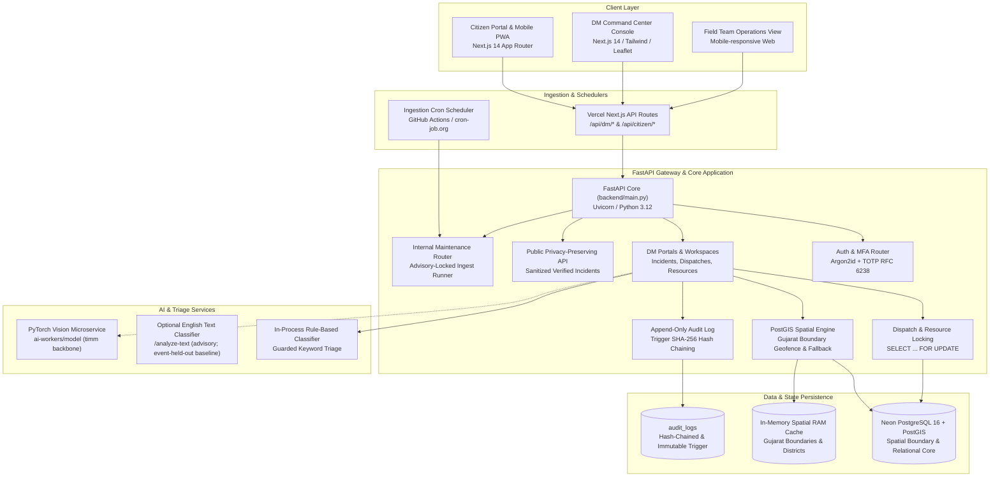
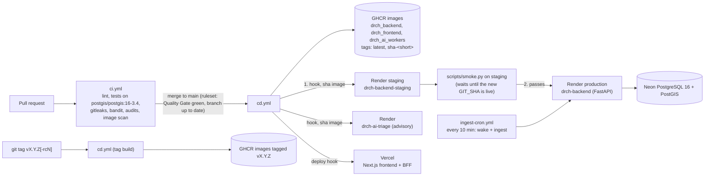

# ResQ — Architecture Reference

## 1. System Overview

The **ResQ** platform is an operational incident coordination platform built specifically for the State of Gujarat. The system coordinates three distinct user groups:
1. **Citizens:** Submit geolocated disaster reports with media attachments, receive safety bulletins, track report status, and locate relief shelters.
2. **Disaster Management (DM) Staff & Dispatchers:** Triage and verify incoming citizen reports, inspect AI suggestions, monitor district operational heatmaps, and dispatch response teams and equipment with concurrency-safe resource locking.
3. **Field Teams & Responders:** Receive assignments, acknowledge dispatches, log progress timestamps (`EN_ROUTE`, `ON_SCENE`, `COMPLETED`), and provide ground situation updates.

### Scope & Supported Scenarios
The platform enforces a strict three-scenario operational scope:
- `cyclone` (Coastal inundation, severe windstorm damage)
- `industrial_fire` (Chemical, petrochemical, or urban major factory fires)
- `urban_flooding` (Monsoon waterlogging and urban gridlock across Gujarat municipal zones)

Any unsupported or out-of-scope events (e.g., earthquakes) are strictly categorized as `other_disaster` without automated triage escalation.

---

## 2. High-Level System Architecture



---

## 3. Repository Directory Structure

```text
IT314_Software_Project/
├── .agents/                    # Agent orchestration rules and guidelines
│   └── rules/                  # Architecture, backend, frontend, security rule definitions
├── .github/
│   ├── workflows/
│   │   ├── ci.yml              # PR validation (Lint, SAST, PostGIS DB tests, Quality Gate)
│   │   ├── cd.yml              # CD pipeline (GHCR container publish, Vercel/Render deploy, smoke gate)
│   │   └── ingest-cron.yml     # 10-minute scheduled backup ingestion runner
│   ├── CODEOWNERS              # Pull request review assignment rules
│   └── PULL_REQUEST_TEMPLATE.md# Team PR template with verification checklist
├── ai-workers/                 # Standalone AI workers and model evaluation
│   ├── text_model/             # English crisis-text dataset, training and inference
│   ├── model/                  # Deep learning image classifier microservice & test harness
│   │   ├── app.py              # PyTorch/timm image triage service
│   │   ├── train_disaster_types.py # Training pipeline
│   │   └── test_api_on_split.py    # Per-class recall and F1 evaluation harness
│   ├── Dockerfile              # Container specification for AI microservice
│   └── worker.py               # Background consumer stub
├── backend/                    # Core Python / FastAPI Backend application
│   ├── app/
│   │   ├── routers/            # API routing layer
│   │   │   ├── auth.py         # Staff login, Argon2id, TOTP MFA challenge & verify
│   │   │   ├── internal.py     # Scheduled ingestion runner protected by advisory locks
│   │   │   ├── public.py       # Public unauthenticated incidents & campaigns API
│   │   │   └── dm/             # Disaster Management command center endpoints
│   │   │       ├── ai.py           # Advisory AI triage and similarity endpoints
│   │   │       ├── dispatches.py   # Dispatch order creation & team status updates
│   │   │       ├── incidents.py    # Incident lifecycle transitions (VERIFY, RESOLVE, etc.)
│   │   │       ├── resources.py    # Resource inventory & warehouse supplies
│   │   │       └── staff.py        # Staff user and role administration
│   │   ├── schemas/            # Pydantic data transfer models
│   │   │   └── citizen.py      # Citizen report, incident, and alert schemas
│   │   ├── services/           # Reusable domain business logic
│   │   │   ├── ai_provider.py      # Triage provider abstraction & in-process classifier
│   │   │   ├── dispatch.py         # Shared dispatch transitions & overdue escalation
│   │   │   ├── incidents.py        # Incident status validation & notification hooks
│   │   │   ├── recommendations.py  # Spatial team proximity & recommendation ranking
│   │   │   ├── signal_matching.py  # Advisory related-signal suggestions (distance, time, wording, label)
│   │   │   ├── resources.py        # Row-level locked resource allocations & release
│   │   │   └── spatial_sync.py     # Upstream Gujarat district GeoJSON sync worker
│   │   ├── audit.py            # Audit log recording & cryptographic hash-chain verifier
│   │   ├── auth.py             # Staff identity dependencies & token validation
│   │   ├── cli.py              # Administrative CLI commands (create-staff, verify-audit)
│   │   ├── common.py           # Shared system enums (IncidentStatus, ScenarioType, Role)
│   │   ├── config.py           # Settings management via pydantic_settings & env vars
│   │   ├── db.py               # Connection pool manager & transaction context
│   │   ├── errors.py           # Standardized API error handlers (SRS s.15.7)
│   │   ├── geo.py              # PostGIS boundary validation & OSM/Google fallback geocoder
│   │   ├── migrate.py          # Sequential SQL schema migration runner
│   │   └── security.py         # AES-GCM encryption & constant-time comparison helpers
│   ├── db/
│   │   ├── migrations/         # Version-controlled idempotent schema migrations
│   │   │   ├── 01_schema.sql             # Base tables, triggers, hash-chain audit log
│   │   │   ├── 02_dm_module.sql          # DM extensions, status history, triage results
│   │   │   ├── 03_core_extensions.sql    # Ingest runs, alerts, fallback flags, campaigns
│   │   │   ├── 04_spatial_boundaries.sql # PostGIS administrative boundary tables
│   │   │   └── 10_signal_matching.sql    # Signal geom sync trigger + pending-signal indexes
│   │   └── seeds/              # Seed data (applied by app.migrate and scripts/seed_reset.py)
│   │       ├── reference/      # 10_reference_data.sql: reference data, always applied
│   │       ├── demo/           # Demo incidents and signal clusters (development only)
│   │       └── optional/       # Extra demo data, loaded by hand
│   ├── tests/                  # Pytest automated test suite
│   │   ├── conftest.py         # Database fixtures, app client setup, CI test guards
│   │   ├── test_auth.py        # Staff 2FA authentication, lockouts & token revocation
│   │   ├── test_dispatch.py    # Concurrency resource locking & dispatch state transitions
│   │   ├── test_incidents.py   # Incident verification state machine & transition rules
│   │   ├── test_recommendations.py # Team ranking & spatial distance calculations
│   │   └── test_units.py       # Non-DB unit tests & /api/v1/health commit verification
│   ├── Dockerfile              # Production multi-stage runner for FastAPI
│   └── main.py                 # Primary FastAPI application entrypoint & lifespan
├── docs/                       # Project documentation
│   ├── api_contracts.md        # Detailed REST API specification
│   ├── ARCHITECTURE.md         # This document
│   ├── env-variables.md        # Complete environment variables register
│   └── testing.md              # Test execution & PostGIS container setup guide
├── frontend/                   # Next.js 14 / React 19 / Tailwind CSS Web Application
│   ├── src/
│   │   ├── app/                # Next.js App Router pages and proxy endpoints
│   │   │   ├── api/            # Server-side API proxy routes (dm, citizen, session)
│   │   │   ├── citizen/        # Citizen dashboard
│   │   │   ├── dm/             # Dispatcher command center workspace
│   │   │   │   ├── incidents/  # Incident queue, triage, decision & dispatch panels
│   │   │   │   ├── dispatches/ # Active field dispatches
│   │   │   │   └── resources/  # Inventory management
│   │   │   ├── login/          # Staff 2FA login & Citizen login
│   │   │   ├── report/         # Citizen disaster reporting form
│   │   │   └── my-reports/     # Citizen tracking timeline
│   │   ├── components/         # Reusable UI components & role views
│   │   │   ├── dm/             # Tactical GIS map layers & operations UI
│   │   │   ├── role-views/     # Dedicated role views (Admin, Citizen, Responder)
│   │   │   ├── ui.tsx          # Base UI design system primitives
│   │   │   └── badges.tsx      # Severity, priority, and status indicators
│   │   ├── context/            # React context providers (ResQContext.tsx)
│   │   ├── lib/                # Client utilities (api.ts, geo.ts, session.ts, format.ts)
│   │   └── services/           # Frontend API service adapters (authApi.ts, citizenApi.ts)
│   └── Dockerfile              # Next.js container build specification
├── scripts/                    # Automation and operational maintenance scripts
│   ├── seed_reset.py           # Automated DB reset & seed application
│   ├── smoke.py                # End-to-end smoke test runner (core loop: report, verify, public map)
│   ├── smoke.sh                # Bash black-box prober for manual runs (CI and CD use smoke.py)
│   └── sync_boundaries.py      # Standalone PostGIS boundary loader
├── docker-compose.yml          # Local multi-container development environment
├── docker-compose.prod.yml     # Production container stack
├── render.yaml                 # Render cloud deployment specification
└── ruff.toml                   # Python code quality and lint configuration
```

---

## 4. Module Responsibilities

### 4.1 Backend Architecture

- **Application Lifespan & Startup ([`backend/main.py`](file:///c:/Users/shahs/OneDrive/Desktop/My%20Folder/DAIICT/Sem5/Software/IT314_Software_Project/backend/main.py)):**
  - Instantiates the FastAPI application, mounts error handlers, and configures CORS.
  - Controls lifecycle initialization via `lifespan(app)`: executes schema migrations ([`backend/app/migrate.py`](file:///c:/Users/shahs/OneDrive/Desktop/My%20Folder/DAIICT/Sem5/Software/IT314_Software_Project/backend/app/migrate.py)), preloads Gujarat PostGIS boundary polygons into RAM cache, and starts background workers.
  - Mounts routes under `/api/v1` namespaces (`/api/v1/auth`, `/api/v1/dm`, `/api/v1/public`, `/api/v1/internal`) alongside `/health` and `/api/v1/health`.

- **Authentication & Security ([`backend/app/auth.py`](file:///c:/Users/shahs/OneDrive/Desktop/My%20Folder/DAIICT/Sem5/Software/IT314_Software_Project/backend/app/auth.py), [`backend/app/security.py`](file:///c:/Users/shahs/OneDrive/Desktop/My%20Folder/DAIICT/Sem5/Software/IT314_Software_Project/backend/app/security.py)):**
  - **Zero Supabase:** Strictly application-managed authentication.
  - Staff authentication enforces a two-step handshake: Argon2id password verification followed by RFC 6238 TOTP validation using encrypted secrets (AES-GCM / Fernet).
  - Failed logins are tracked; five consecutive failed attempts lock the account for 15 minutes and invalidate active sessions by bumping `token_version`.

- **Database & Concurrency Management ([`backend/app/db.py`](file:///c:/Users/shahs/OneDrive/Desktop/My%20Folder/DAIICT/Sem5/Software/IT314_Software_Project/backend/app/db.py)):**
  - Manages PostgreSQL connection pools using `psycopg_pool.ConnectionPool`.
  - Exposes atomic context-managed transactions (`with db.transaction() as conn:`).
  - Handles row-level resource allocation locks (`SELECT ... FOR UPDATE`) and PostgreSQL advisory session locks (`pg_try_advisory_xact_lock`).

- **Geospatial & Boundary Engine ([`backend/app/geo.py`](file:///c:/Users/shahs/OneDrive/Desktop/My%20Folder/DAIICT/Sem5/Software/IT314_Software_Project/backend/app/geo.py)):**
  - Enforces Gujarat jurisdiction for incoming incident coordinates via PostGIS `ST_Contains` spatial queries against `administrative_boundaries`.
  - Provides a 2-tier geocoding fallback when coordinates are missing: Google Maps Geocoding API (if key configured) falling back to OpenStreetMap Nominatim.
  - Preloads boundary polygons into RAM for sub-millisecond in-process containment checks.

- **Hash-Chained Audit Trail ([`backend/app/audit.py`](file:///c:/Users/shahs/OneDrive/Desktop/My%20Folder/DAIICT/Sem5/Software/IT314_Software_Project/backend/app/audit.py)):**
  - Implements an immutable audit log table (`audit_logs`) governed by a database trigger (`fn_audit_log_hash_chain`).
  - Each entry stores a SHA-256 hash chaining the current row contents with the preceding row's `row_hash`.
  - Table triggers explicitly block `UPDATE` and `DELETE` operations.
  - Verifiable at runtime or via the administrative CLI (`python -m app.cli verify-audit`).

### 4.2 Frontend Architecture

- **Next.js App Router Structure ([`frontend/src/app/`](file:///c:/Users/shahs/OneDrive/Desktop/My%20Folder/DAIICT/Sem5/Software/IT314_Software_Project/frontend/src/app/)):**
  - Unified codebase serving Citizen, Dispatcher, and Responder views through role-guarded routes and views.
  - Uses server-side API proxy routes (`/api/dm/[...path]` and `/api/citizen/[...path]`) to securely forward requests to the FastAPI backend while managing session cookies.
- **State & Context Management ([`frontend/src/context/ResQContext.tsx`](file:///c:/Users/shahs/OneDrive/Desktop/My%20Folder/DAIICT/Sem5/Software/IT314_Software_Project/frontend/src/context/ResQContext.tsx)):**
  - Holds active authenticated user identity, role, simulated mode state, active alert notifications, and local UI caches.

### 4.3 AI Workers & Models Architecture

- **In-Process Advisory Classifier ([`backend/app/services/ai_provider.py`](file:///c:/Users/shahs/OneDrive/Desktop/My%20Folder/DAIICT/Sem5/Software/IT314_Software_Project/backend/app/services/ai_provider.py)):**
  - Active default triage provider for the backend API.
  - Applies deterministic keyword heuristics, confidence scoring, and strict prompt-injection guardrails.
  - Results are marked advisory; stored in `triage_results` and never automatically alter incident states.
- **English Text Analysis ([`ai-workers/text_model/`](../ai-workers/text_model/)):**
  - Optional `/analyze-text` endpoint trained on an openly licensed, event-held-out English crisis-message corpus.
  - Predicts disaster relevance, help request/offer, direct reports, and available humanitarian information categories.
  - Does not replace `/triage` and does not infer the operational scenario, priority, location, or event time because the training labels do not support those outputs.
  - Requires a separately supplied local model artifact; ingestion is not connected to it yet.
- **Standalone Vision Model Service ([`ai-workers/model/app.py`](file:///c:/Users/shahs/OneDrive/Desktop/My%20Folder/DAIICT/Sem5/Software/IT314_Software_Project/ai-workers/model/app.py)):**
  - Microservice utilizing a `timm` PyTorch backbone for classifying disaster imagery (`fire`, `flood`, `hurricane`, `other_disaster`).
  - Evaluated on test splits via [`test_api_on_split.py`](file:///c:/Users/shahs/OneDrive/Desktop/My%20Folder/DAIICT/Sem5/Software/IT314_Software_Project/ai-workers/model/test_api_on_split.py) with class-specific review thresholds.

---

## 5. Existing Reusable Components & Services

Before introducing new components or functions, developers must inspect and reuse the following established modules:

### Reusable Backend Services & Utilities
| Module / Symbol | Location | Reusable Capabilities |
| :--- | :--- | :--- |
| `dispatch` service | [`backend/app/services/dispatch.py`](file:///c:/Users/shahs/OneDrive/Desktop/My%20Folder/DAIICT/Sem5/Software/IT314_Software_Project/backend/app/services/dispatch.py) | `transition_dispatch()`, `escalate_overdue()`, shared state machine validation |
| `resources` service | [`backend/app/services/resources.py`](file:///c:/Users/shahs/OneDrive/Desktop/My%20Folder/DAIICT/Sem5/Software/IT314_Software_Project/backend/app/services/resources.py) | Atomic row-locked resource allocation, `release_all_for_dispatch()` |
| `recommendations` engine | [`backend/app/services/recommendations.py`](file:///c:/Users/shahs/OneDrive/Desktop/My%20Folder/DAIICT/Sem5/Software/IT314_Software_Project/backend/app/services/recommendations.py) | PostGIS distance calculation, team suitability ranking, workload scoring |
| `geo` module | [`backend/app/geo.py`](file:///c:/Users/shahs/OneDrive/Desktop/My%20Folder/DAIICT/Sem5/Software/IT314_Software_Project/backend/app/geo.py) | `validate_coordinates_in_gujarat()`, `reverse_geocode_district()`, boundary cache |
| `audit` logger & verifier | [`backend/app/audit.py`](file:///c:/Users/shahs/OneDrive/Desktop/My%20Folder/DAIICT/Sem5/Software/IT314_Software_Project/backend/app/audit.py) | `log_audit_event()`, `verify_audit_log_hash_chain()` |
| `db` transaction context | [`backend/app/db.py`](file:///c:/Users/shahs/OneDrive/Desktop/My%20Folder/DAIICT/Sem5/Software/IT314_Software_Project/backend/app/db.py) | `with db.transaction() as conn:`, connection pool access |
| `errors` framework | [`backend/app/errors.py`](file:///c:/Users/shahs/OneDrive/Desktop/My%20Folder/DAIICT/Sem5/Software/IT314_Software_Project/backend/app/errors.py) | `AppError`, standardized error response formatting conforming to SRS s.15.7 |
| `common` enums | [`backend/app/common.py`](file:///c:/Users/shahs/OneDrive/Desktop/My%20Folder/DAIICT/Sem5/Software/IT314_Software_Project/backend/app/common.py) | `IncidentStatus`, `DispatchStatus`, `PriorityLevel`, `ScenarioType`, `Role` |

### Reusable Frontend Components & Libraries
| Component / Module | Location | Reusable Capabilities |
| :--- | :--- | :--- |
| `Brand.tsx` (Logo, LogoMark, Brand, SiteHeader, NavLink) | [`frontend/src/components/Brand.tsx`](file:///c:/Users/shahs/OneDrive/Desktop/My%20Folder/DAIICT/Sem5/Software/IT314_Software_Project/frontend/src/components/Brand.tsx) | Final Q-Radar logo (light/dark lockup, symbol) and the single shared top bar (56px, navy) used by every page; assets in `frontend/public/logo*.svg` and `frontend/src/app/icon.svg` |
| `ui.tsx` Primitives | [`frontend/src/components/ui.tsx`](file:///c:/Users/shahs/OneDrive/Desktop/My%20Folder/DAIICT/Sem5/Software/IT314_Software_Project/frontend/src/components/ui.tsx) | Base buttons, cards, modals, dialogs, form inputs, badges |
| `badges.tsx` | [`frontend/src/components/badges.tsx`](file:///c:/Users/shahs/OneDrive/Desktop/My%20Folder/DAIICT/Sem5/Software/IT314_Software_Project/frontend/src/components/badges.tsx) | Color-coded status badges for incidents, dispatches, and priority levels |
| `LiveOperationsLayer` | [`frontend/src/components/dm/LiveOperationsLayer.tsx`](file:///c:/Users/shahs/OneDrive/Desktop/My%20Folder/DAIICT/Sem5/Software/IT314_Software_Project/frontend/src/components/dm/LiveOperationsLayer.tsx) | Interactive Leaflet tactical map with incidents, teams, and shelter markers |
| `AlertsDrawer` | [`frontend/src/components/AlertsDrawer.tsx`](file:///c:/Users/shahs/OneDrive/Desktop/My%20Folder/DAIICT/Sem5/Software/IT314_Software_Project/frontend/src/components/AlertsDrawer.tsx) | Sliding tray displaying official emergency bulletins and warning alerts |
| `api.ts` Client Wrapper | [`frontend/src/lib/api.ts`](file:///c:/Users/shahs/OneDrive/Desktop/My%20Folder/DAIICT/Sem5/Software/IT314_Software_Project/frontend/src/lib/api.ts) | Unified HTTP client handling JWT headers, base URL resolution, and error parsing |
| `geo.ts` Helpers | [`frontend/src/lib/geo.ts`](file:///c:/Users/shahs/OneDrive/Desktop/My%20Folder/DAIICT/Sem5/Software/IT314_Software_Project/frontend/src/lib/geo.ts) | Haversine distance, Gujarat coordinate bounding box verification |

---

## 6. Architectural Principles & Operational Conventions

1. **Human-in-the-Loop Dispatcher Decisions:**
   - AI recommendations must never automatically verify incidents, modify incident priorities, or execute dispatch orders. All algorithmic outputs are purely advisory and stored in dedicated `triage_results` records. Human dispatcher action is strictly required.

2. **Strict Concurrency & Allocation Safety:**
   - Resource quantities must be allocated atomically using PostgreSQL `SELECT ... FOR UPDATE` row locks within a single transaction to prevent race conditions or over-allocation.
   - External ingestion loops use PostgreSQL transactional advisory locks (`pg_try_advisory_xact_lock`) to eliminate duplicate runs between webhooks and cron triggers.

3. **Public Privacy Protection (PII Scrubbing):**
   - The public incident feed ([`backend/app/routers/public.py`](file:///c:/Users/shahs/OneDrive/Desktop/My%20Folder/DAIICT/Sem5/Software/IT314_Software_Project/backend/app/routers/public.py)) strictly excludes reporter names, phone numbers, and citizen identifiers.
   - Coordinates on public feeds are truncated to 4 decimal places (~11m precision) to obscure exact private residential addresses.

4. **Cryptographic Auditability:**
   - All state transitions and administrative actions record immutable entries in `audit_logs`. Database triggers compute a SHA-256 hash incorporating the previous row's hash.

5. **Standardized API Error Envelope:**
   - Every non-2xx API error conforms strictly to the schema:
     ```json
     {
       "error": {
         "code": "STRING_CONSTANT_CODE",
         "message": "Human-readable explanation of error",
         "details": null
       }
     }
     ```

---

## 7. Implementation Status: Real vs. Simulated

To maintain factual engineering clarity, capabilities in the repository are catalogued by their verified implementation status:

| Capability / Module | Implementation Status | Verification Details |
| :--- | :--- | :--- |
| **Staff 2FA Authentication** | **Implemented (Real)** | Argon2id + RFC 6238 TOTP, account lockout, tested in `test_auth.py` |
| **Incident Verification Workflow** | **Implemented (Real)** | Strict transition validation, history recording, tested in `test_incidents.py` |
| **Resource Allocation Concurrency** | **Implemented (Real)** | `SELECT FOR UPDATE` row-level locks, conflict rejection, tested in `test_dispatch.py` |
| **Hash-Chained Audit Trail** | **Implemented (Real)** | SHA-256 trigger chain, UPDATE/DELETE blocked, verified by `verify-audit` CLI |
| **Gujarat Boundary Geofencing** | **Implemented (Real)** | PostGIS `ST_Contains` spatial checks, RAM caching, Nominatim/Google fallback |
| **Team Recommendation Engine** | **Implemented (Real)** | PostGIS proximity sorting, capability scoring, tested in `test_recommendations.py` |
| **Internal Ingestion Runner** | **Implemented (Real)** | Advisory lock protected `/api/v1/internal/ingest/run` & cron workflow |
| **Advisory Text AI Triage** | **Implemented (Real)** | In-process rule-based classifier with guardrails (`app.services.ai_provider`) |
| **English Crisis Text Model** | **Experimental / Optional** | Real-data event-held-out baseline at `ai-workers/text_model`; separate `/analyze-text` endpoint, not connected to ingestion |
| **Image Disaster Classifier** | **Prototype / Isolated** | PyTorch service in `ai-workers/model/app.py`, evaluated offline on split data |
| **Payment Gateway Integration** | **Simulated (Sandbox)** | Sandbox `MockGateway` only; live Razorpay/Stripe integration is planned |
| **External Alert & Signal Ingestion** | **Implemented (Real feeds) + Replay** | USGS and SACHET CAP adapters (`app/services/ingest/`) run on the scheduler and the `ingest-cron.yml` workflow; social posts are a replay fixture; `GNEWS` and `BLUESKY` adapters exist but are off by default (`NEWS_RSS_ENABLED`, `BLUESKY_SEARCH_ENABLED`); fallback alerts stay labelled `is_fallback = TRUE` |
| **Simulated Demo Incidents** | **Simulated** | 4 seeded Gujarat demo incidents flagged with `is_simulated = TRUE` |

---

## 8. Deployment & Release Overview (S3-12, S3-18)



| Concern | How it is handled | Reference |
|---|---|---|
| Hosting | Neon (database), Render free web services for the backend and the AI triage service (`render.yaml`), a separate Render staging backend with its own Neon branch (created in the Render console, not in `render.yaml`), Vercel (frontend and the BFF proxies) | `render.yaml`, [release-runbook.md](release-runbook.md) §1 |
| Configuration and secrets | Every secret is entered by Siddh in the Render, Vercel and GitHub consoles; the repository lists names only | [env-variables.md](env-variables.md) |
| Migrations | Forward-only SQL files applied by `python -m app.migrate` (also at backend start-up) under an advisory lock; a Neon branch is taken before each release | [runbook-migration.md](runbook-migration.md) |
| Continuous deployment | `cd.yml` runs only on `main` or a release tag (a release tag must point at a commit on `main`); the `main` branch ruleset already requires a pull request with the `Pipeline Status / Quality Gate` check green and the branch up to date, so CD does not re-run CI. CD compares each commit with the last CD run that succeeded (not just its parent), so a run cancelled by a newer merge, or one that failed, does not lose its changes. Vercel starts without waiting for any image build, and each Render job waits only for its own image. A merge to `main` publishes the changed images, deploys the backend image for that commit to staging, waits for its `GIT_SHA` on `/api/v1/health` and runs the smoke test there. Production (Render) deploys only if that passes, then waits for the same `GIT_SHA`. Vercel and the AI triage service deploy by their own hooks. A deploy whose hook secret is missing is shown as skipped, not successful. A newer push cancels an older CD run | `.github/workflows/cd.yml` |
| Releases and rollback | A `vX.Y.Z` / `vX.Y.Z-rcN` tag builds all images from that commit with the version as the image tag; releases are deployed and rolled back by pointing Render at a version (or `sha-`) tag | [release-runbook.md](release-runbook.md) §2, §4 |
| Cold start | Render free instances sleep; `ingest-cron.yml` wakes the backend every 10 minutes; open `/api/v1/health` before a demo | [release-runbook.md](release-runbook.md) §1 |
| Fallback hosting | `docker-compose.prod.yml` runs the same images (PostGIS, backend, frontend, AI workers) on any Docker host; it refuses to start when a required secret is missing | `docker-compose.prod.yml` |
| Backups | Neon branches before releases; `pg_dump` / `pg_restore` for a portable copy | [runbook-migration.md](runbook-migration.md) |
| Demo and rehearsal | Roles, script, on-stage fallbacks and rehearsal log | [demo-script.md](demo-script.md) |
