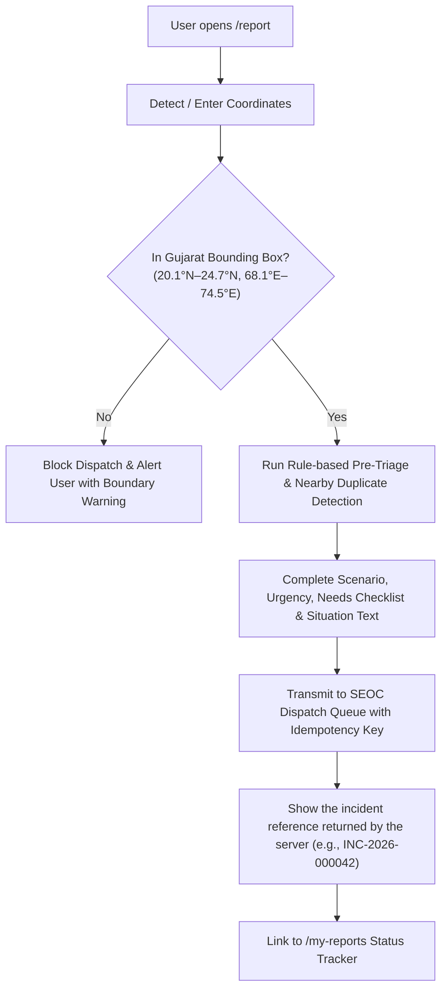
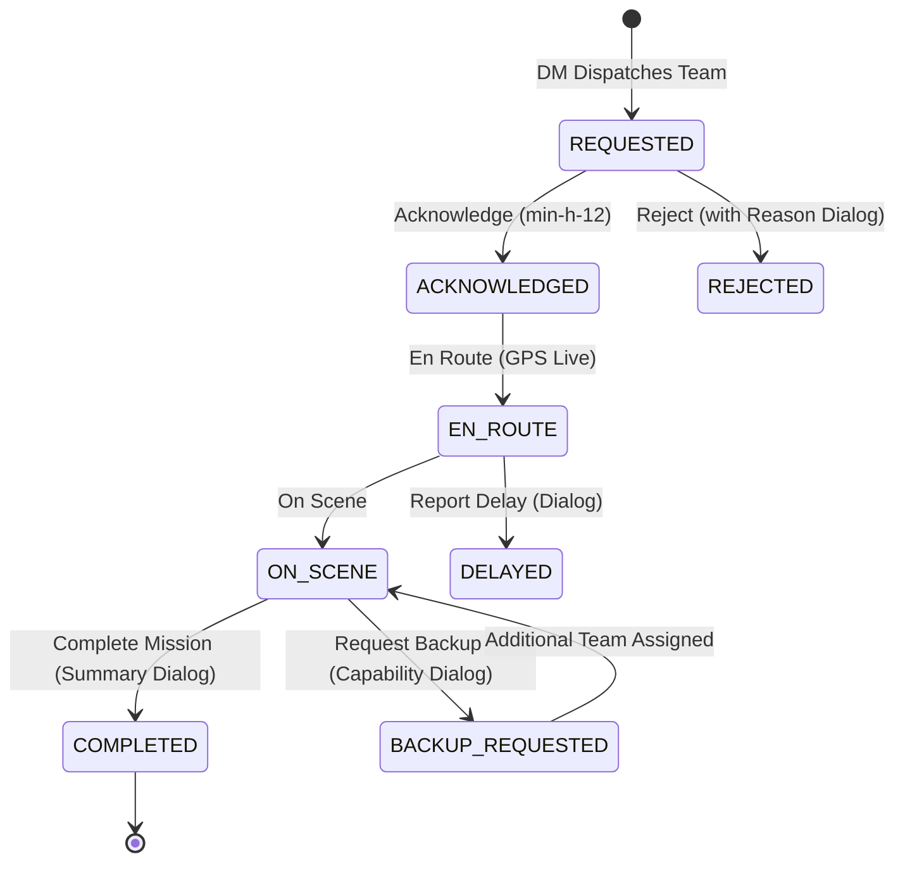

# ResQ Gujarat — Frontend Operations & Accessibility Runbook

**Document Version:** 1.0.0  
**Author / Component Lead:** Janvi Patel (`JanviVPatel`) — Frontend Lead (Citizen & Field Responder Interfaces)  
**Applicable Interfaces:** `/report`, `/my-reports`, `/field`, `/donate`  
**Platform Target:** Disaster Response Coordination Hub (DRCH) — Gujarat State Operations  
**Compliance Standards:** WCAG 2.1 AA, Responsive Breakpoints (320px–1280px+), Glove-friendly Field Controls (48px)

---

## 1. Executive Summary

This guide serves as the definitive operational manual and design specification for the citizen-facing and field-responder web interfaces of the **ResQ Gujarat Disaster Management Platform**. It details the user journey, validation invariants, real-time polling synchronizations, keyboard navigation protocols, mobile responsiveness criteria, and payment recovery mechanisms implemented across Sprint 1, Sprint 2, and Sprint 3.

---

## 2. Core Frontend Architectures & Interfaces

### 2.1 Interface Directory & Responsibilities

| Route | Primary Persona | Core Functionality | Key Source Files |
| :--- | :--- | :--- | :--- |
| `/report` | Citizen / Bystander | Gujarat-bounded emergency incident creation, GPS verification, pre-triage rule hints, and duplicate warnings. | `frontend/src/app/report/page.tsx`, `frontend/src/services/preTriage.ts` |
| `/my-reports` | Citizen / Reporter | Live 15-second status tracking timeline (`SUBMITTED` → `VERIFIED` → `DISPATCHED` → `RESOLVED`), and two-way info replies (S2-13). | `frontend/src/app/my-reports/page.tsx`, `frontend/src/services/citizenApi.ts` |
| `/field` | Frontline Field Team | Tactical dispatch queue, glove-friendly state progression (`ACKNOWLEDGE` → `EN_ROUTE` → `ON_SCENE` → `COMPLETE`), delay reporting, backup requests. | `frontend/src/app/field/page.tsx`, `frontend/src/components/ui.tsx` |
| `/donate` | Philanthropist / Citizen | Crisis relief fund contributions, transparent sandbox simulation, decline/abandon/timeout edge-case recovery (S3-11). | `frontend/src/app/donate/page.tsx` |

---

## 3. Citizen Emergency Incident Reporting (`/report`)

### 3.1 Lifecycle & Validation Invariants



1. **State Bounding Invariant:** Every incident must fall strictly within the geographic boundaries of Gujarat State ($20.1^\circ\text{N} - 24.7^\circ\text{N}, 68.1^\circ\text{E} - 74.5^\circ\text{E}$). The system rejects coordinates outside this bounding box to prevent sending Gujarat emergency responders to locations outside jurisdiction.
2. **Advisory Pre-Triage Hints:** Client-side rule evaluation (`preTriage`) analyzes keywords in the description (e.g., "trapped", "infant", "chest pain", "rising water") and suggests an advisory urgency level without overriding citizen intent.
3. **Nearby Duplicate Awareness:** Queries public verified incidents within 2,500m of the selected coordinate. If a matching incident exists, the citizen is notified while retaining the right to submit additional eyewitness reports.
4. **Idempotency Protection:** Form sessions generate a `crypto.randomUUID()` idempotency token to prevent double-dispatch in congested 3G/4G network conditions.

---

## 4. Live Polling & Citizen Status Timeline (`/my-reports`)

### 4.1 15-Second Background Polling Architecture
- Both `/my-reports` and `/field` refresh in the background every 15,000 ms with `setInterval`. The interval is cleared on unmount, and `/field` ignores a response that arrives after the page has unmounted.
- `/my-reports` shows the time of the last successful refresh in an `aria-live="polite"` region (visible from the `md` breakpoint up). The time is rendered only after the first load: a time rendered on the server uses a different format than the browser and causes a hydration error, so the server renders a placeholder (`…`).

### 4.2 Four-Stage Incident Progression Matrix

| Stage | Code State | Visual Badge | Operational Meaning |
| :---: | :--- | :--- | :--- |
| **1** | `SUBMITTED` | Amber Badge | Logged in gateway queue; awaiting dispatcher review. |
| **2** | `VERIFIED` | Sky Blue Badge | Verified by SEOC Dispatcher; tactical requirements assessed. |
| **3** | `DISPATCHED` | Purple Badge | Field team assigned and mobilized toward scene. |
| **4** | `RESOLVED` / `CLOSED` | Emerald / Slate Badge | Emergency cleared, casualties assisted, incident closed. |

### 4.3 Citizen Information Reply
When dispatchers flag an incident as `NEEDS_INFORMATION`, the report card dynamically surfaces a high-visibility orange response banner. Citizens can provide additional details (e.g., landmark directions, stranded counts), instantly pushing data back into the dispatcher's triage view.

---

## 5. Frontline Field Responder Operations (`/field`)

### 5.1 Glove-Friendly Touch Philosophy
Field teams operate in severe weather (rain, cyclone winds, low-visibility nighttime conditions). UI controls adhere to:
- **Minimum 48px Touch Height:** Main tactical action buttons use `min-h-12` (48px) with wide tap radiuses.
- **High-Contrast Sunlight Visibility:** High-contrast text palettes against dark slate backgrounds prevent screen glare washout under direct Gujarat sunlight.
- **Single-Handed Thumb Zones:** Critical action buttons (`Acknowledge`, `En Route`, `On Scene`, `Complete`) occupy full-width or side-by-side equal-split layouts at mobile widths ($< 640\text{px}$).

### 5.2 Tactical Dispatch Progression Lifecycle



---

## 6. Payment Endings (`/donate`)

After an order is created the donation page can end in one of four states. Each failure state names the order and amount, says whether money moved, and offers a next step. Focus moves to the state heading when it appears, and errors that stay on the order screen use `role="alert"`.

| State | When it is shown | What the donor can do |
| :--- | :--- | :--- |
| `confirmed` | The server verified the signature and returned a receipt number. | Make another contribution, view the map. |
| `declined` | The gateway or server rejected the payment: `INVALID_SIGNATURE` or an HTTP 400 or 402 answer. The server's reason is shown. | Retry the payment, or go back and change the details (the form keeps its values). |
| `timed_out` | A payment call gets no answer within 20 seconds, or the network connection is lost. | Check status and re-verify, or start a new contribution. |
| `abandoned` | The donor presses "Cancel & Abandon Order". | Resume the contribution or return to the map. |

Other server errors (for example 409 `DONATION_NOT_PENDING` or a 5xx) stay on the order screen as an error message with the server's text.

**Limits to know about**
- There is no cancel or status endpoint yet, so an abandoned or timed-out order stays `PENDING` on the server. The screens say "no payment is confirmed until the gateway reports it" and do not promise a refund timeline.
- `GET /me/donations` and the payment webhook are not built yet (see issue #102), so a donor cannot look a receipt up later.

**Sandbox preview.** When `NEXT_PUBLIC_PAYMENT_SANDBOX=true` the order screen shows a "Sandbox: preview a payment ending" panel with **Preview Decline** and **Preview Timeout** buttons. They only show the screens; nothing is sent to the gateway, and the screens are labelled "(preview)" with a "SANDBOX PREVIEW" notice. A real decline or timeout is labelled without "(preview)".

---

## 7. Accessibility (a11y) & WCAG 2.1 AA Compliance Matrix

### 7.1 Keyboard Focus & ARIA Specification

| Component | Selector / Element | Keyboard Trigger | Focus Treatment | ARIA Attributes |
| :--- | :--- | :--- | :--- | :--- |
| **Scenario Cards** | `button[role="radio"]` inside `role="radiogroup"` | `Tab` reaches the selected card; `Arrow` keys move the selection and focus | `focus-visible:ring-2 focus-visible:ring-sky-400 ring-offset-2` | `role="radiogroup"` with `aria-label`, `role="radio"`, `aria-checked`; roving `tabIndex` |
| **Urgency Buttons** | `button[role="radio"]` inside `role="radiogroup"` | `Tab` reaches the selected option; `Arrow` keys move the selection and focus | `focus-visible:ring-2 focus-visible:ring-sky-400 ring-offset-1` | `role="radiogroup"` with `aria-label`, `role="radio"`, `aria-checked`; roving `tabIndex` |
| **Needs Checkbox** | `label:has(input)` | `Tab`, `Space` | `focus-within:ring-2 focus-within:ring-sky-400 ring-offset-1` | Accessible native checkbox wrapped in label |
| **Form Inputs** | `input`, `textarea` | `Tab` | `focus-visible:ring-2 focus-visible:ring-sky-400` | Visible `<label>`; `aria-required="true"` on the situation description |
| **Field Action Buttons** | `button.min-h-12` | `Tab`, `Enter` | `focus-visible:ring-2 focus-visible:ring-sky-500 ring-offset-2` | `aria-busy="true/false"` during sync |
| **Dialog Modals** | native `<dialog>` opened with `showModal()` | `Escape` closes; `Tab` stays inside while open | Focus moves into the dialog on open and returns to the control that opened it on close | `aria-labelledby="dialog-title"` |

### 7.2 Mobile Responsiveness

Checked in a browser at **375 px width** (the "mobile" preset): `/donate`, `/field`, `/my-reports` and `/report` have no horizontal scrolling, and the field and report controls fit the screen.

- **Touch targets:** primary actions on `/field`, `/my-reports` and `/donate` are at least 44 px tall (`min-h-11` or `min-h-[44px]`); the main field actions use `min-h-12` (48 px).
- **Layout:** grids stack to one column on narrow screens (`grid-cols-1 sm:grid-cols-2`), headers wrap instead of overflowing, and the timeline connectors only show from `sm` up.
- **Page scrolling:** the document scrolls normally. Only `/` (map) and the `/dm` workspace use the fixed full-screen `.app-screen` layout, and the `/dm` workspace scrolls inside its own pane. Do not set `overflow:hidden` or `100vh` on `body`.
- **Shared header:** every page uses `SiteHeader` / `NavLink` from `components/Brand.tsx` (56 px bar, header links at least 44 px tall). The map header collapses secondary links into a menu below `lg`.
- **Containers:** page content is centred with `max-w-4xl` or `max-w-5xl` on wide screens.

---

## 8. Verification & QA Testing Runbook

To verify frontend stability, zero console regressions, and accessibility compliance, run the following test suite:

```bash
# 1. Lint and Static Code Analysis (Strict 0 Errors)
npm --prefix frontend run lint

# 2. Production type-check and route generation (must finish with no errors)
npm --prefix frontend run build

# 3. Interactive Keyboard Navigation Audit
# Launch local server
npm --prefix frontend run dev
# Tab through /report, verify focus ring on all scenario buttons, inputs, and submit button.
# Tab through /my-reports, trigger Timeline View with keyboard Enter key.
# Tab through /field, open Reject Dialog and close with Escape key.
```

---

*ResQ Gujarat Engineering Team — Safe, Resilient, Accessible Disaster Coordination.*
