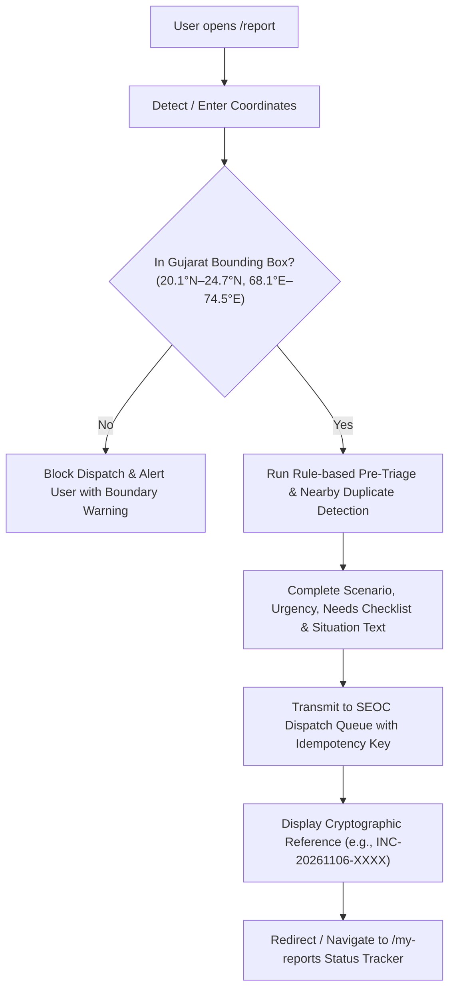
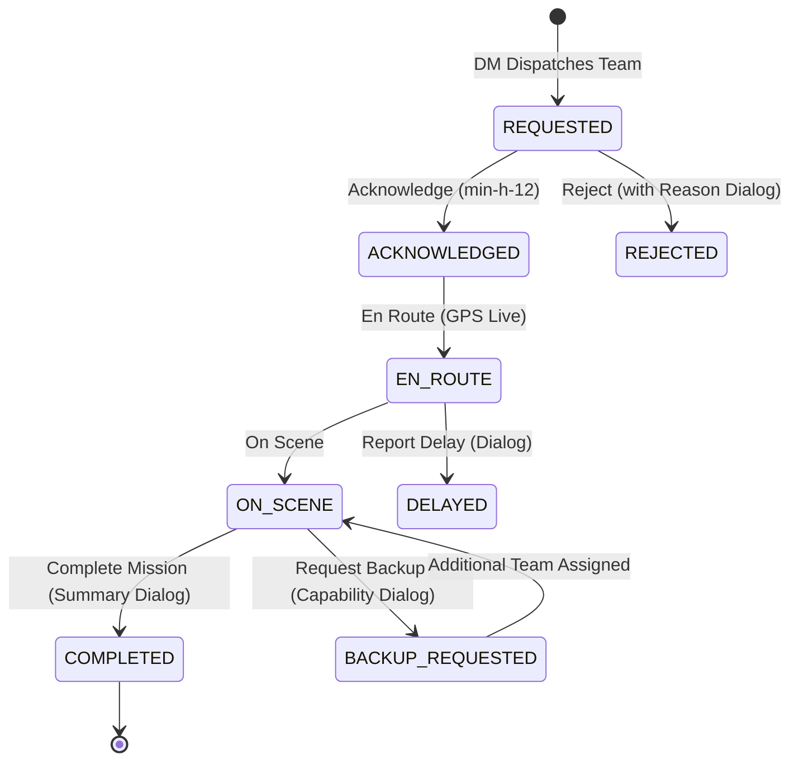

# ResQ Gujarat — Frontend Operations & Accessibility Runbook (S3-16)

**Document Version:** 1.0.0  
**Author / Component Lead:** Janvi Patel (`JanviVPatel`) — Frontend Lead (Citizen & Field Responder Interfaces)  
**Applicable Interfaces:** `/report`, `/my-reports`, `/field`, `/donate`  
**Platform Target:** Disaster Response Coordination Hub (DRCH) — Gujarat State Operations  
**Compliance Standards:** WCAG 2.1 AA, Responsive Breakpoints (320px–1280px+), Glove-friendly Field Controls (48px)

---

## 1. Executive Summary

This guide serves as the definitive operational manual and design specification for the citizen-facing and field-responder web interfaces of the **ResQ Gujarat Disaster Management Platform**. It details the user journey, validation invariants, real-time polling synchronizations, keyboard navigation protocols, mobile responsiveness criteria, and payment recovery mechanisms implemented across Sprint 1, Sprint 2, and Sprint 3.

---

## 2. Core Frontend Architectures & Interfaces

### 2.1 Interface Directory & Responsibilities

| Route | Primary Persona | Core Functionality | Key Source Files |
| :--- | :--- | :--- | :--- |
| `/report` | Citizen / Bystander | Gujarat-bounded emergency incident creation, GPS verification, pre-triage rule hints, and duplicate warnings. | `frontend/src/app/report/page.tsx`, `frontend/src/services/preTriage.ts` |
| `/my-reports` | Citizen / Reporter | Live 15-second status tracking timeline (`SUBMITTED` → `VERIFIED` → `DISPATCHED` → `RESOLVED`), and two-way info replies (S2-13). | `frontend/src/app/my-reports/page.tsx`, `frontend/src/services/citizenApi.ts` |
| `/field` | Frontline Field Team | Tactical dispatch queue, glove-friendly state progression (`ACKNOWLEDGE` → `EN_ROUTE` → `ON_SCENE` → `COMPLETE`), delay reporting, backup requests. | `frontend/src/app/field/page.tsx`, `frontend/src/components/ui.tsx` |
| `/donate` | Philanthropist / Citizen | Crisis relief fund contributions, transparent sandbox simulation, decline/abandon/timeout edge-case recovery (S3-11). | `frontend/src/app/donate/page.tsx` |

---

## 3. Citizen Emergency Incident Reporting (`/report`)

### 3.1 Lifecycle & Validation Invariants



1. **State Bounding Invariant:** Every incident must fall strictly within the geographic boundaries of Gujarat State ($20.1^\circ\text{N} - 24.7^\circ\text{N}, 68.1^\circ\text{E} - 74.5^\circ\text{E}$). The system rejects coordinates outside this bounding box to prevent sending Gujarat emergency responders to locations outside jurisdiction.
2. **Advisory Pre-Triage Hints:** Client-side rule evaluation (`preTriage`) analyzes keywords in the description (e.g., "trapped", "infant", "chest pain", "rising water") and suggests an advisory urgency level without overriding citizen intent.
3. **Nearby Duplicate Awareness:** Queries public verified incidents within 2,500m of the selected coordinate. If a matching incident exists, the citizen is notified while retaining the right to submit additional eyewitness reports.
4. **Idempotency Protection:** Form sessions generate a `crypto.randomUUID()` idempotency token to prevent double-dispatch in congested 3G/4G network conditions.

---

## 4. Live Polling & Citizen Status Timeline (`/my-reports`)

### 4.1 15-Second Background Polling Architecture
- Both `/my-reports` and `/field` execute silent, non-blocking background polling every 15,000ms (`setInterval` with clean `AbortController`/unmount lifecycle management).
- Timestamps are displayed in accessible `aria-live="polite"` indicators, informing users when the data was last confirmed by state servers.

### 4.2 Four-Stage Incident Progression Matrix

| Stage | Code State | Visual Badge | Operational Meaning |
| :---: | :--- | :--- | :--- |
| **1** | `SUBMITTED` | Amber Badge | Logged in gateway queue; awaiting dispatcher review. |
| **2** | `VERIFIED` | Sky Blue Badge | Verified by SEOC Dispatcher; tactical requirements assessed. |
| **3** | `DISPATCHED` | Purple Badge | Field team assigned and mobilized toward scene. |
| **4** | `RESOLVED` / `CLOSED` | Emerald / Slate Badge | Emergency cleared, casualties assisted, incident closed. |

### 4.3 Citizen Information Reply (SRS S2-13)
When dispatchers flag an incident as `NEEDS_INFORMATION`, the report card dynamically surfaces a high-visibility orange response banner. Citizens can provide additional details (e.g., landmark directions, stranded counts), instantly pushing data back into the dispatcher's triage view.

---

## 5. Frontline Field Responder Operations (`/field`)

### 5.1 Glove-Friendly Touch Philosophy
Field teams operate in severe weather (rain, cyclone winds, low-visibility nighttime conditions). UI controls adhere to:
- **Minimum 48px Touch Height:** Main tactical action buttons use `min-h-12` (48px) with wide tap radiuses.
- **High-Contrast Sunlight Visibility:** High-contrast text palettes against dark slate backgrounds prevent screen glare washout under direct Gujarat sunlight.
- **Single-Handed Thumb Zones:** Critical action buttons (`Acknowledge`, `En Route`, `On Scene`, `Complete`) occupy full-width or side-by-side equal-split layouts at mobile widths ($< 640\text{px}$).

### 5.2 Tactical Dispatch Progression Lifecycle



---

## 6. Payment Recovery & Edge-Case Safeguards (`/donate`)

In compliance with Sprint 3 Requirement **S3-11**, the donation interface provides deterministic handling for payment gateway edge cases:

1. **Explicit Edge-Case States:**
   - `declined`: User card/UPI payment declined by bank; surfaces specific reversal notes and one-click retry preserving form state.
   - `abandoned`: User closes gateway modal or cancels flow; preserves campaign and donor details so the donor doesn't re-type info.
   - `timed_out`: Gateway network handshake expires; instructs donor to verify bank statement before retrying, preventing double-debits.
2. **Sandbox Simulation Panel:** Under developer / demonstration environments, the interface renders explicit sandbox controls (`Simulate Declined`, `Simulate Abandoned`, `Simulate Timed-Out`, `Simulate Success`) to enable deterministic testing without real financial transactions.
3. **Reversal Invariant Notice:** Clear legal and operational disclaimer that unsuccessful or failed charges are released by banking switches within 3–5 working days.

---

## 7. Accessibility (a11y) & WCAG 2.1 AA Compliance Matrix

### 7.1 Keyboard Focus & ARIA Specification

| Component | Selector / Element | Keyboard Trigger | Focus Treatment | ARIA Attributes |
| :--- | :--- | :--- | :--- | :--- |
| **Scenario Cards** | `button[role="radio"]` | `Tab`, `Space`, `Enter` | `focus-visible:ring-2 focus-visible:ring-sky-400 ring-offset-2` | `role="radio"`, `aria-checked="true/false"` |
| **Urgency Buttons** | `button[role="radio"]` | `Tab`, `ArrowKeys`, `Space` | `focus-visible:ring-2 focus-visible:ring-sky-400 ring-offset-1` | `role="radiogroup"`, `role="radio"`, `aria-checked` |
| **Needs Checkbox** | `label:has(input)` | `Tab`, `Space` | `focus-within:ring-2 focus-within:ring-sky-400 ring-offset-1` | Accessible native checkbox wrapped in label |
| **Form Inputs** | `input`, `textarea` | `Tab` | `focus-visible:ring-2 focus-visible:ring-sky-400` | `aria-required="true"`, `aria-describedby` |
| **Field Action Buttons** | `button.min-h-12` | `Tab`, `Enter` | `focus-visible:ring-2 focus-visible:ring-sky-500 ring-offset-2` | `aria-busy="true/false"` during sync |
| **Dialog Modals** | `dialog[aria-labelledby]` | `Escape` to close, `Tab` trap | Automatic modal focus trap via HTML5 `<dialog>` | `aria-labelledby="dialog-title"` |

### 7.2 Mobile Responsiveness Breakpoints

- **`< 380px` (Ultra-Compact Phone):** Navigation header links compress into compact icons/abbreviations; grid stacks into single column (`grid-cols-1`); button touch heights stay $\ge 44\text{px}$.
- **`380px – 640px` (Standard Smartphone):** Scenario cards stack or use 2-column compact grid; quick-count selectors display touch chips; modal sheets scale to 95% viewport width.
- **`640px – 1024px` (Tablet / Responder Mobile Mount):** 2-column coordinate and urgency grids; full stage timeline displayed with horizontal connectors.
- **`> 1024px` (Desktop / Command Center):** Centered max-width containers (`max-w-4xl` / `max-w-5xl`) with high-density informational hierarchy.

---

## 8. Verification & QA Testing Runbook

To verify frontend stability, zero console regressions, and accessibility compliance, run the following test suite:

```bash
# 1. Lint and Static Code Analysis (Strict 0 Errors)
npm --prefix frontend run lint

# 2. Production Type-Check & Static Route Generation (32 Routes)
npm --prefix frontend run build

# 3. Interactive Keyboard Navigation Audit
# Launch local server
npm --prefix frontend run dev
# Tab through /report, verify focus ring on all scenario buttons, inputs, and submit button.
# Tab through /my-reports, trigger Timeline View with keyboard Enter key.
# Tab through /field, open Reject Dialog and close with Escape key.
```

---

*ResQ Gujarat Engineering Team — Safe, Resilient, Accessible Disaster Coordination.*
