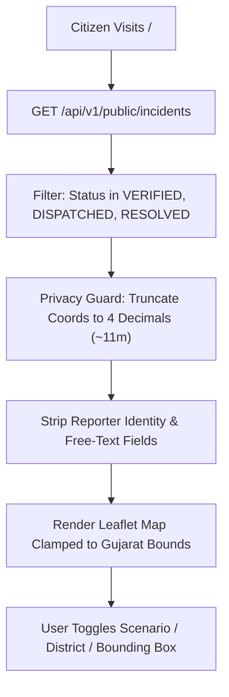

# ResQ Gujarat — Dispatcher Workspace & Public Portal Operations Guide

**Document Version:** 1.0.0  
**Author / Component Lead:** Tanishq Shah (`Tanishq7361`) — Frontend Lead (Public Site & Dispatcher Workspace)  
**Applicable Interfaces:** `/`, `/about`, `/how-to`, `/safety`, `/dm/incidents`, `/dm/incidents/[id]`, `/dm/team-requests`, `/dm/signals`, `/dm/analytics`  
**Platform Target:** Disaster Response Coordination Hub (DRCH) — Gujarat State Operations  
**Compliance Standards:** WCAG 2.1 AA, Strict Human-in-the-Loop Governance, Public PII Safeguards

---

## 1. Executive Summary

This manual serves as the definitive operational specification and user runbook for the public-facing portals and State Emergency Operations Center (SEOC) dispatcher workspace of the **ResQ Gujarat Disaster Management Platform**. It codifies architectural boundaries, verification workflows, AI-human decision governance, team dispatching, signal ingestion triage, and operational analytics implemented across Sprint 1, Sprint 2, and Sprint 3.

---

## 2. Interface Directory & Responsibilities

| Route | Persona | Core Responsibilities | Key Source Files |
| :--- | :--- | :--- | :--- |
| `/` | General Public | Public GIS map locked to Gujarat State boundaries, real-time verified incident markers, scenario and district filters, and emergency dial buttons. | `frontend/src/app/page.tsx`, `frontend/src/components/public/PublicPage.tsx`, `frontend/src/lib/geo.ts` |
| `/about`, `/how-to`, `/safety` | General Public | Platform scope disclosure (real vs. simulated), multi-role step-by-step guides, and verified NDMA/GSDMA/ERSS hazard safety guidelines. | `frontend/src/app/about/page.tsx`, `frontend/src/app/how-to/page.tsx`, `frontend/src/app/safety/page.tsx` |
| `/login`, `/signup` | All Users | Accessible trilingual authentication (English, Hindi, Gujarati), offline indicator, immediate emergency call buttons, and TOTP staff challenge. | `frontend/src/app/login/page.tsx`, `frontend/src/components/auth/AuthShell.tsx`, `frontend/src/components/auth/AuthLanguage.tsx` |
| `/dm/incidents/[id]` | Dispatcher / Supervisor | Incident verification, priority assignment, duplicate linking, advisory AI text triage, advisory photo analysis, and team dispatch allocation. | `frontend/src/app/dm/incidents/[id]/page.tsx`, `dispatch-panel.tsx`, `ai-panel.tsx`, `decision-panel.tsx`, `duplicates-panel.tsx` |
| `/dm/team-requests` | Dispatcher / Lead | Review additional resource requests submitted from field units; approve to generate pre-filled dispatch drafts or decline with rationale. | `frontend/src/app/dm/team-requests/page.tsx` |
| `/dm/signals` | Dispatcher / Supervisor | Ingested external signals queue (USGS, CAP/SACHET, social alerts); promote signal to verified incident candidate or dismiss with rationale. | `frontend/src/app/dm/signals/page.tsx` |
| `/dm/analytics` | SEOC Command Staff | Operational analytics, median time-to-verify/close, AI vs. human decision distribution chart, and confidence band evaluations. | `frontend/src/app/dm/analytics/page.tsx` |

---

## 3. Public GIS Portal & Citizen Privacy Invariants



### 3.1 Geographic Locking & Privacy Safeguards
1. **Gujarat Bounding Invariant:** Map viewport is locked via `setMaxBounds` to Gujarat coordinates ($20.1^\circ\text{N} - 24.7^\circ\text{N}, 68.1^\circ\text{E} - 74.5^\circ\text{E}$). Panning outside Gujarat is strictly prevented in both client and server.
2. **Reporter Confidentiality:** The public API and map components never expose citizen names, phone numbers, email addresses, or uncurated free-text descriptions. Only canonical incident references, verified scenario types, districts, urgency ratings, and timestamps are displayed.
3. **Coordinate Truncation:** Incident coordinates displayed on the public map are rounded to 4 decimal places (~11 meters), preventing tactical reconnaissance of individual residences while ensuring accurate neighborhood-level community warnings.
4. **Verification Gate:** Submissions with status `SUBMITTED`, `NEEDS_INFORMATION`, or `REJECTED` are excluded from the public layer. Only incidents validated by a human dispatcher appear publicly.

---

## 4. Dispatcher Operations Workflow & Decision Invariants

```mermaid
sequenceDiagram
    autonumber
    actor Dispatcher as SEOC Dispatcher
    participant DM_UI as Dispatcher UI (/dm)
    participant BFF as Next.js BFF Proxy
    participant Backend as FastAPI Core
    participant AI as AI services (triage, image classifier)

    Dispatcher->>DM_UI: Select Incident from /dm/incidents
    DM_UI->>Backend: GET /api/v1/dm/incidents/{id}
    Backend-->>DM_UI: Incident Details + Allowed Actions
    
    rect rgb(240, 248, 255)
        Note over Dispatcher,AI: Advisory AI Decision Support
        Dispatcher->>DM_UI: Request AI Triage / Upload Scene Photo
        DM_UI->>BFF: POST /api/dm/incidents/{id}/ai-triage or /photo-analyse
        BFF->>Backend: Same request with the session token
        Backend->>AI: Inference request (personal data removed; photo sent only for analysis)
        AI-->>Backend: Advisory prediction and confidence
        Backend-->>DM_UI: Advisory result (audited; incident unchanged)
        Note over DM_UI: Render "Advisory Only — Not Verified"
    end

    rect rgb(255, 250, 240)
        Note over Dispatcher,Backend: Human-in-the-Loop Verification
        Dispatcher->>DM_UI: Verify Incident (Assign Priority & Rationale)
        DM_UI->>Backend: POST /incidents/{id}/verification (Idempotency-Key)
        Backend-->>DM_UI: Status Updated to VERIFIED
    end

    rect rgb(240, 255, 240)
        Note over Dispatcher,Backend: Team Allocation & Dispatch
        DM_UI->>Backend: GET /incidents/{id}/team-recommendations
        Backend-->>DM_UI: Ranked Teams (Capabilities, Distance, Secondary Tags)
        Dispatcher->>DM_UI: Select Recommended Unit & Confirm Dispatch
        DM_UI->>Backend: POST /incidents/{id}/dispatches
        Backend-->>DM_UI: Dispatch Order Created (REQUESTED)
    end
```

### 4.1 Strict Human-in-the-Loop Governance
- **No Autonomous State Transitions:** Machine learning models (both text triage and image classification) are strictly advisory. AI systems cannot change an incident's status, verify an emergency, or trigger resource dispatch autonomously.
- **Separate Audit Recording:** When a dispatcher accepts, modifies, or rejects an AI recommendation, the human decision, rationale, timestamp, and operator ID are recorded in `ai_recommendations` and chained into the immutable SHA-256 audit log.
- **Photo Analysis (S3-08):** A dispatcher can upload one JPEG, PNG or WebP scene photo (up to 10 MB) from the AI panel. The backend checks the file's real type from its first bytes, sends it to the image classifier and returns the top class with a confidence. `fire`, `flood` and `hurricane` map to the supported scenarios `industrial_fire`, `urban_flooding` and `cyclone`; `earthquake`, `landslide` and `other_disaster` are shown as out of scope, and `not_disaster` as "no disaster detected". The photo is never stored on the incident, the result is never a verification, and each analysis writes an `AI_PHOTO_ANALYSED` audit entry. If the model is not configured or does not answer, the panel shows "Photo analysis model is currently unavailable" and manual triage carries on. Set `AI_IMAGE_SERVICE_URL` to enable it. When the frontend is hosted on a platform that caps request bodies (for example about 4.5 MB on Vercel), larger photos are rejected before they reach the backend.

### 4.2 Team Recommendation & Dispatch Integration
- **Multi-Factor Scoring:** Available response teams (`NDRF`, `SDRF`, Municipal Fire Brigades) are scored by:
  $$\text{Score} = (\text{Primary Capability Groups} \times 10) + (\text{Secondary Matches} \times 3) - (\text{Distance km} \times 0.08)$$
- **Advisory Labeling:** Recommendations are clearly marked with: *"Advisory — you confirm the dispatch"*.
- **Empty Team Fallback:** If all matching units are deployed or out of range, the dispatch panel renders: *"No available team matches; allocate manually"*, ensuring dispatchers are prompted to request inter-agency mutual aid rather than facing a blank interface.
- **Idempotent Dispatch:** *Add to dispatch* only pre-fills the form; the dispatcher confirms, and dispatch creation carries an idempotency key so a repeated submit does not double-book a team.

---

## 5. Field Team Backup Requests (`/dm/team-requests`)

1. **Queue Architecture:** Field teams encountering escalating hazards (e.g. hazardous chemical leaks during an urban flood) can submit additional capability requests directly from `/field`.
2. **Dispatcher Review:** Open requests appear in real time on `/dm/team-requests`.
3. **Approval Flow:** Clicking *Approve* generates a pre-filled dispatch draft populated with the incident reference, suggested unit, and field notes. No dispatch is finalized until confirmed by the dispatcher.
4. **Decline Flow:** Clicking *Decline* prompts for a mandatory operator rationale (minimum 3 characters) and logs an audit entry.

---

## 6. External Hazard Signals Queue (`/dm/signals`)

1. **Ingestion Sources:** Automated pipelines ingest real-time seismic events from the USGS API, official weather alerts from SACHET/CAP feeds, and emergency social media posts.
2. **AI Pre-Labeling:** Ingested signals receive pre-triage classification labels and confidence scores to accelerate situational awareness.
3. **Promotion Protocol:** Authorized operators (`PUBLISHER` or `SUPERVISOR` role) can promote a signal into a `SUBMITTED` incident candidate. A promoted signal remains invisible to the public until formally verified by SEOC dispatchers.
4. **Dismissal Protocol:** False alarms or duplicate chatter are dismissed with a mandatory rationale.

---

## 7. AI vs. Human Decision Analytics (`/dm/analytics`)

1. **Decision Metrics:** Tracks the proportion of AI suggestions accepted verbatim, modified with dispatcher adjustments, or rejected outright.
2. **Confidence Stratification:** Disaggregates performance across three standardized confidence bands:
   - **High Confidence ($\ge 80\%$):** Expected primary alignment; monitored for automation bias.
   - **Medium Confidence ($60\% - 79\%$):** Routine human review required.
   - **Low Confidence ($< 60\%$):** Flagged for manual triage; candidates for model retraining.
3. **By Scenario:** A table shows accepted, modified, rejected and undecided suggestions for each scenario, and rows with no recorded confidence appear as a separate band.
4. **Out-of-Scope Segregation:** Suggestions outside the three supported scenarios (cyclone, industrial fire, urban flooding) are counted separately to prevent skewing operational metrics.

---

## 8. Accessibility & Technical Invariants (WCAG 2.1 AA)

- **Contrast Ratios:** Text and critical UI components maintain a minimum contrast ratio of 4.5:1 against backgrounds (7:1 for headers).
- **Touch Targets:** All interactive buttons, tabs, and select fields adhere to a minimum 44px × 44px hit target (48px for emergency actions).
- **Trilingual Accessibility:** The auth shell supports English, Hindi, and Gujarati with proper `lang` attributes, live form validation hints, and accessible emergency dial buttons (112, 108, 101, 1070).
- **Keyboard Navigation:** Panels follow a sequential tab order with visible focus rings. Dialogs are native modal `<dialog>` elements: `Escape` closes them and focus returns to the control that opened them.
