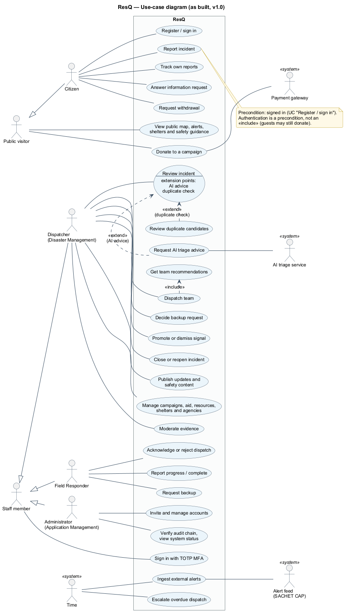

# ResQ: Use Cases (final)

Group 30. This document updates the use cases of SRS v1 §7 to match the system as built (v1.0). Requirement IDs refer to [01-requirements-srs-v2.md](01-requirements-srs-v2.md).

## 1. Actors

| Actor | Kind | Description |
|---|---|---|
| Citizen (Normal User) | Primary | Registered member of the public. Reports incidents, tracks them, donates. |
| Public visitor | Primary | Anyone without an account. Reads the public map, alerts, shelters and safety content. |
| Dispatcher (Disaster Management) | Primary | Operational staff. Has some of the PUBLISHER, MODERATOR, CLOSURE, DISPATCH and SUPERVISOR permissions. |
| Field Responder (Field Team) | Primary | Member of a response team (a `TEAM` resource). Sees only that team's dispatches. |
| Administrator (Application Management) | Primary | Manages accounts, permissions, audit and system status. Has no operational access. |
| Payment gateway | Secondary system | Sandbox mock or Razorpay test mode. Hosts checkout and sends signed webhooks. |
| Alert feeds | Secondary system | SACHET CAP feed (Gujarat), replay fixture, and optional Google News and Bluesky. |
| AI triage service | Secondary system | `drch-ai-triage`. Gives advisory scenario, priority and confidence. |
| Scheduler | Secondary system | Backend background timer (escalation every 60 s; an ingestion poller in development only) and GitHub `ingest-cron` (ingestion every 15 minutes in staging and production). |

## 2. Use-case diagram

Source: [diagrams/use-case.puml](diagrams/use-case.puml)

## 3. Use-case index

| UC | Name | Primary actor | Requirements | Sprint |
|---|---|---|---|---|
| UC-01 | Register / sign in | Citizen | NU-FR-01 | S1, S3 |
| UC-02 | Report incident | Citizen | NU-FR-03, 04, 05 | S1 |
| UC-03 | Track my reports | Citizen | NU-FR-06, 07 | S1–S2 |
| UC-04 | Answer information request | Citizen | NU-FR-11 | S2 |
| UC-05 | Request withdrawal | Citizen | NU-FR-12 | S2 |
| UC-06 | Donate to campaign | Citizen | NU-FR-09 | S2–S3 |
| UC-07 | View public map, alerts, shelters, safety | Public visitor | NU-FR-08, 16 | S1–S3 |
| UC-08 | Staff sign-in with TOTP MFA | Dispatcher, Field, Admin | DM-FR-01, AM-FR-01 | S0 |
| UC-09 | Verify / reject / request information | Dispatcher | DM-FR-03, 06 | S0–S1 |
| UC-10 | Review AI triage advice | Dispatcher | DM-FR-05 | S1–S2 |
| UC-11 | Review duplicates | Dispatcher | DM-FR-04 | S0, S3 |
| UC-12 | Dispatch team | Dispatcher | DM-FR-08, 09, 22 | S0–S2 |
| UC-13 | Decide team request | Dispatcher (DISPATCH) | DM-FR-23 | S2 |
| UC-14 | Promote / dismiss signal | Dispatcher (PUBLISHER or SUPERVISOR) | DM-FR-21 | S2 |
| UC-15 | Close / reopen incident | Dispatcher (CLOSURE) | DM-FR-15 | S0 |
| UC-16 | Publish updates and safety content | Dispatcher (PUBLISHER) | DM-FR-11, 17 | S2–S3 |
| UC-17 | Manage campaigns, aid, resources, shelters, agencies | Dispatcher | DM-FR-12, 13, 16, 19, 20, 24 | S0–S3 |
| UC-18 | Moderate evidence | Dispatcher (MODERATOR) | DM-FR-18 | S3 |
| UC-19 | Acknowledge / reject dispatch | Field Responder | FT-FR-02 | S2 |
| UC-20 | Report progress, request backup, complete | Field Responder | FT-FR-03, 04, 05 | S2 |
| UC-21 | Invite staff and manage accounts | Administrator | AM-FR-02, 15, 16 | S1–S3 |
| UC-22 | Verify audit chain, view system status | Administrator | AM-FR-04, 05 | S3 |
| UC-23 | Ingest external alerts | Scheduler | DM-FR-21, 27 | S2 |
| UC-24 | Escalate overdue dispatch | Scheduler | DM-FR-09 | S0 |

## 4. Use-case specifications

The specifications below cover the main flows in full. Every use case that changes state writes an `audit_logs` entry; this is not repeated in each one.

### UC-02 Report incident

- **Actor:** Citizen. **Requirements:** NU-FR-03, NU-FR-04, NU-FR-05.
- **Preconditions:** the citizen is signed in (UC-01).
- **Main flow:**
  1. The citizen opens `/report` and picks one of three scenario cards.
  2. The citizen enters a description (10–2000 characters), urgency and people affected, plus optional details.
  3. The citizen sets the location by GPS, a map pin or an address. A hint shows nearby existing incidents.
  4. The client sends `POST /api/v1/incidents` with an `Idempotency-Key`.
  5. The system validates the scenario, checks that the point is inside Gujarat and resolves the district. It creates the incident with status `SUBMITTED` and reference `INC-YYYY-NNNNNN`.
  6. The citizen may then attach up to 5 photos.
  7. The citizen sees the incident on **My reports**.
- **Alternative and exception flows:**
  - 4a. Retrying with the same key returns the original incident; no duplicate is created.
  - 5a. Unsupported scenario: 422 `UNSUPPORTED_SCENARIO`, and the page points to 112 / 101 / 108.
  - 5b. Outside Gujarat: 422 `OUTSIDE_GUJARAT`.
  - 5c. Too many requests: 429.
  - 6a. Photo too large or not an image: 422; the report itself stays.
- **Postconditions:** an incident is `SUBMITTED`, visible to DM staff and not yet public.

### UC-04 Answer information request

- **Actor:** Citizen.
- **Precondition:** the incident is `NEEDS_INFORMATION`.
- **Main flow:**
  1. The citizen receives a notification.
  2. The citizen opens the report and replies with text, a corrected location (checked against Gujarat) and/or a photo.
  3. The reply is stored in the status history and the incident returns to `SUBMITTED`, so it re-enters the verification queue.
- **Exception:** a reply on a report that is no longer waiting for information gets 409.

### UC-06 Donate to campaign

- **Actor:** Citizen (or guest). **Secondary actor:** payment gateway.
- **Precondition:** an `ACTIVE` campaign exists.
- **Main flow:**
  1. The donor chooses the campaign and amount and whether to donate anonymously.
  2. The system creates the donation as `PENDING` and creates a gateway order.
  3. The donor pays in the gateway's checkout.
  4. The browser returns the signature, and the server verifies it. Alternatively, a signed webhook arrives first.
  5. The donation becomes `CONFIRMED` with receipt `REC-YYYY-NNNNNN`.
  6. **My donations** shows the receipt.
- **Exceptions:**
  - The donor cancels → `FAILED` (ABANDONED).
  - The gateway reports a failure → `FAILED` (GATEWAY_DECLINED).
  - 30 minutes pass without payment → `FAILED` (EXPIRED).
  - A webhook replay is ignored.
  - Amount mismatch → rejected and audited.
  - A late verified capture still confirms the donation.
- **Postcondition:** no donation is ever shown as confirmed without verification. See [state diagram](diagrams/png/state-donation.png) and the [Sprint 3 sequence](diagrams/png/sprint3-sequence.png).

### UC-08 Staff sign-in with TOTP MFA

- **Actors:** Dispatcher, Field Responder, Administrator.
- **Main flow:**
  1. The user enters email and password. The system checks the Argon2id hash.
  2. The system answers `mfa_required` with a short-lived MFA token.
  3. The user enters the 6-digit TOTP code. The system verifies it against the encrypted secret.
  4. The system issues the session (access token plus rotating refresh token) in an httpOnly cookie and redirects to the role's home: `/dm`, `/field` or `/admin`.
- **Exceptions:**
  - Wrong credentials → generic 401.
  - 5 failures → account locked for 15 minutes and all sessions revoked.
  - A signed-in user of another role who opens a workspace is redirected to their own area.

### UC-09 Verify / reject / request information

- **Actor:** Dispatcher.
- **Precondition:** the incident is `SUBMITTED` or `NEEDS_INFORMATION`.
- **Main flow:**
  1. The dispatcher opens the incident: evidence, timeline, map, duplicates and AI panel.
  2. The dispatcher chooses Verify (priority and rationale required), Reject (rationale) or Request information (question).
  3. The system locks the row, checks the `version` and applies the transition. It writes the history and notifies the reporter.
- **Extensions:** UC-10 (AI advice) and UC-11 (duplicates) can be used before deciding.
- **Exceptions:**
  - Someone else changed the incident → 409 `VERSION_CONFLICT`.
  - Invalid transition → 409 `INVALID_TRANSITION`.
- **Postcondition:** a `VERIFIED` incident appears on the public map.

### UC-10 Review AI triage advice

- **Actor:** Dispatcher. **Secondary actor:** AI triage service.
- **Main flow:**
  1. The dispatcher clicks *Run AI triage*.
  2. The backend removes PII from the text and calls `/triage`.
  3. The backend applies guardrails and stores the result in `ai_recommendations` (scenario, priority, confidence, factors).
  4. The dispatcher records Accept, Modify or Reject with a rationale.
- **Exceptions:** service down → `UNAVAILABLE`; confidence under the threshold → `LOW_CONFIDENCE`; invalid output → `UNSAFE_OUTPUT`. Manual triage continues in every case.
- **Rule:** the result never changes the incident by itself.

### UC-12 Dispatch team

- **Actor:** Dispatcher (DISPATCH permission).
- **Precondition:** the incident is `VERIFIED` or `DISPATCHED`.
- **Main flow:**
  1. The dispatcher opens the ranked team recommendations (distance, capabilities, reasons).
  2. The dispatcher picks a team and writes instructions.
  3. The system creates a `REQUESTED` dispatch and reserves the resource under a row lock.
  4. The incident becomes `DISPATCHED`.
  5. The field team is notified.
- **Exceptions:**
  - Incident not verified → 409 `INCIDENT_NOT_VERIFIED`.
  - Not enough quantity left → 409 `RESOURCE_CONFLICT`; resource in maintenance or unavailable → 409 `RESOURCE_UNAVAILABLE`. In both cases nothing is created.
  - Same idempotency key → the existing dispatch is returned.
- See the [Sprint 2 sequence](diagrams/png/sprint2-sequence.png).

### UC-14 Promote / dismiss signal

- **Actor:** Dispatcher with the PUBLISHER or SUPERVISOR permission.
- **Precondition:** the signal is `PENDING`.
- **Main flow:**
  1. The dispatcher reviews the signal: source, language, text, simulated flag and related signals.
  2. **Promote:** the system creates a `SUBMITTED` incident attributed to the ingestion system user, and the signal becomes `PROMOTED`.
  3. **Dismiss:** the signal becomes `DISMISSED`.
- **Exceptions:**
  - No coordinates → 422 `NO_LOCATION`.
  - Already handled → 409 `SIGNAL_NOT_PENDING`.

### UC-15 Close / reopen incident

- **Actor:** Dispatcher with the CLOSURE permission.
- **Main flow:**
  1. The dispatcher enters the closure reason and an optional public summary.
  2. The system checks for open dependencies (active dispatches).
  3. The incident becomes `CLOSED`.
- **Exception:** open dependencies → 409 `OPEN_DEPENDENCIES` unless the dispatcher overrides with a rationale.
- **Reopen:** a reason is required. The incident returns to the status it was closed from (RESOLVED → VERIFIED, REJECTED → SUBMITTED).

### UC-19 / UC-20 Field responder handles a dispatch

- **Actor:** Field Responder.
- **Precondition:** a dispatch for the responder's team is `REQUESTED`.
- **Main flow:**
  1. The responder sees it on `/field`.
  2. The responder acknowledges it → `ACKNOWLEDGED`.
  3. The responder reports EN_ROUTE → `DISPATCHED`, then ON_SCENE.
  4. Optionally, the responder raises a backup request (UC-13 for the dispatcher).
  5. The responder completes the dispatch → `COMPLETED`, and its resources are released.
- **Exceptions:**
  - Rejection needs a reason → `REJECTED`.
  - A report on another team's dispatch → 404.
  - A late or contradictory report → 409, audited and not applied.
  - No acknowledgement within the timeout → UC-24 escalation.

### UC-21 Invite staff and manage accounts

- **Actor:** Administrator (also DM supervisors for their own staff).
- **Main flow:**
  1. The inviter enters a name, email and role; for field accounts, also the team.
  2. The invitee receives a single-use link, sets a password and enrols TOTP.
  3. The administrator can disable or enable accounts, sign a user out everywhere, reset credentials and set DM permissions.
- **Exceptions:**
  - Duplicate email → 409.
  - Expired invitation → it can be resent.
  - An administrator cannot raise their own privileges.

### UC-23 Ingest external alerts

- **Actor:** Scheduler, or a dispatcher using "Poll now".
- **Main flow:** see [activity diagram](diagrams/png/activity-ingestion.png). The run takes an advisory lock, then for each enabled adapter it fetches items, sanitises them, stores them and records an `ingest_runs` row.
- **Exception:** another run is active → SKIPPED. A source fails → that run is FAILED and the other sources continue.

### UC-24 Escalate overdue dispatch

- **Actor:** Scheduler (every 60 s).
- **Main flow:** every dispatch still `REQUESTED` after `DISPATCH_ACK_TIMEOUT_MINUTES` (default 15) is escalated once. The system writes `DISPATCH_ESCALATED`, and the dispatch shows as overdue in the console.

## 5. Changes from the v1 use cases

| v1 (SRS §7) | Final |
|---|---|
| 7.1 Incident reporting | UC-02. Gujarat geofence and photos added |
| 7.2 AI-assisted triage | UC-10, unchanged in principle (advisory) |
| 7.3 Monetary donation | UC-06, with server-side endings |
| 7.4 Physical aid contribution | Citizen side **not built**. The DM side is in UC-17 |
| 7.5 Emergency dispatch | UC-12, with the field team acting itself (UC-19/20) instead of staff recording for it |
| 7.6 Registration, login, role assignment | UC-01, UC-08, UC-21 (invitations) |
| 7.7 Evidence and content moderation | UC-18 |
| 7.8 Incident closure | UC-15, plus reopen |
| 7.9 Safety content authoring and approval | UC-16 |
| 7.10 Abuse and rate-limit control | Built into every endpoint (rate limits); there is no separate admin use case |
| 7.11 Data export or deletion (Optional) | Deletion only, part of the citizen account page |
| — | New: UC-07, UC-13, UC-14, UC-19, UC-20, UC-22, UC-23, UC-24 |
