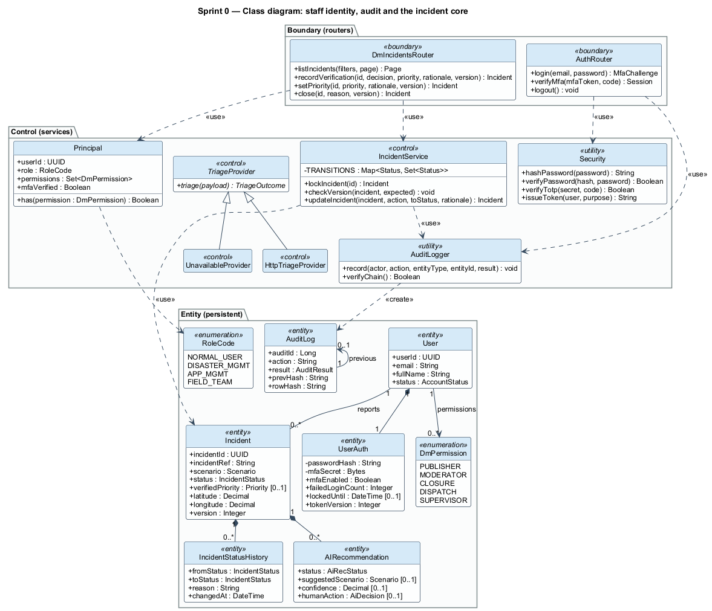
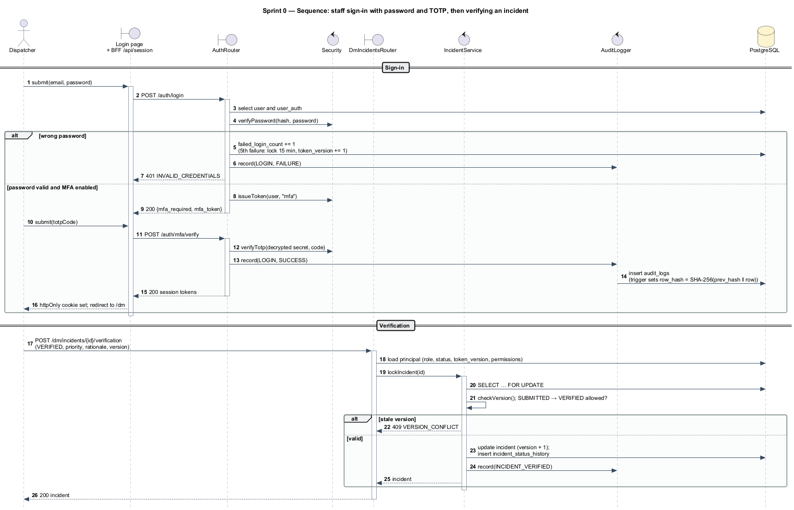
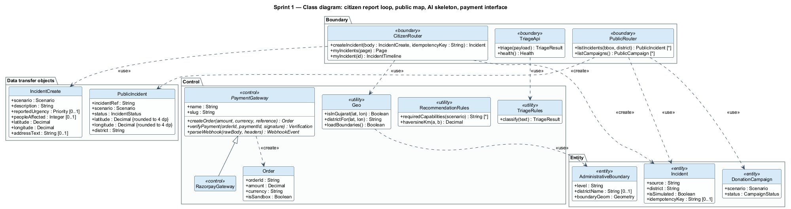
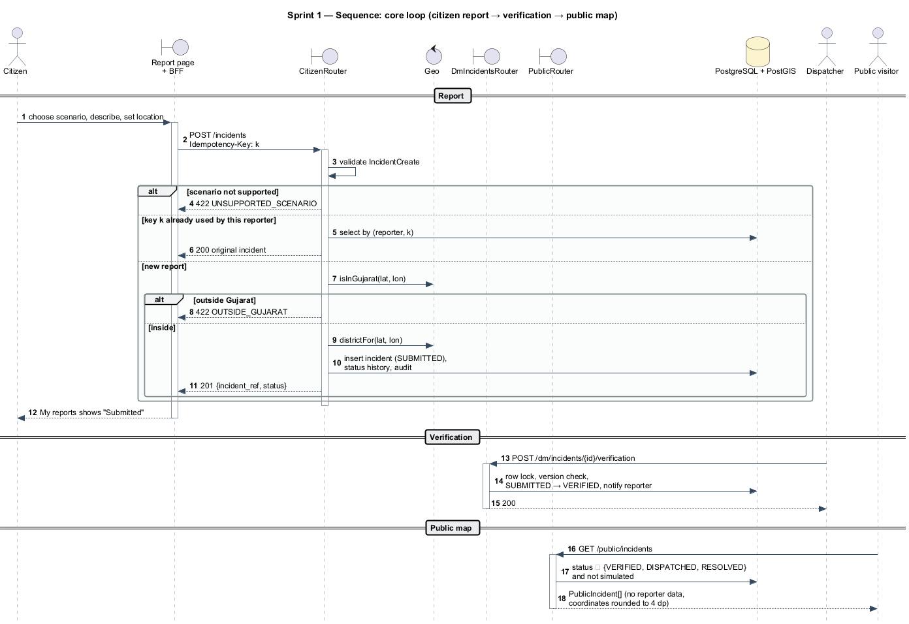
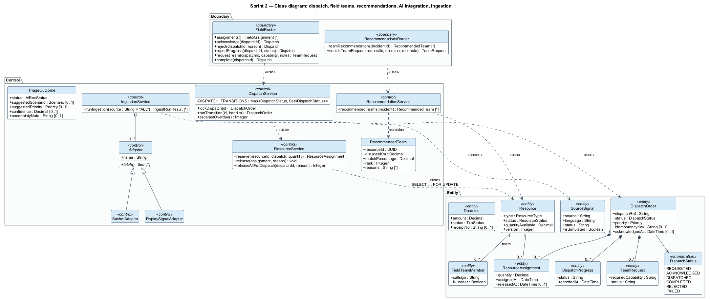
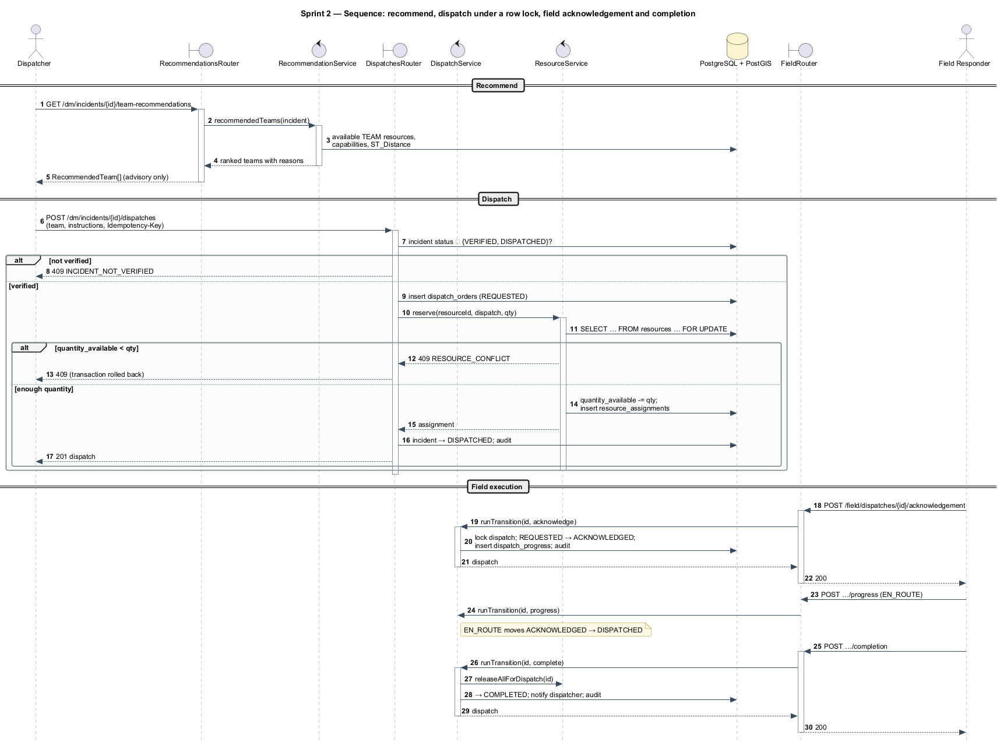
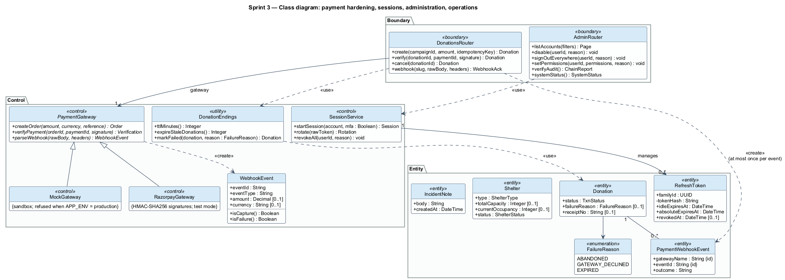
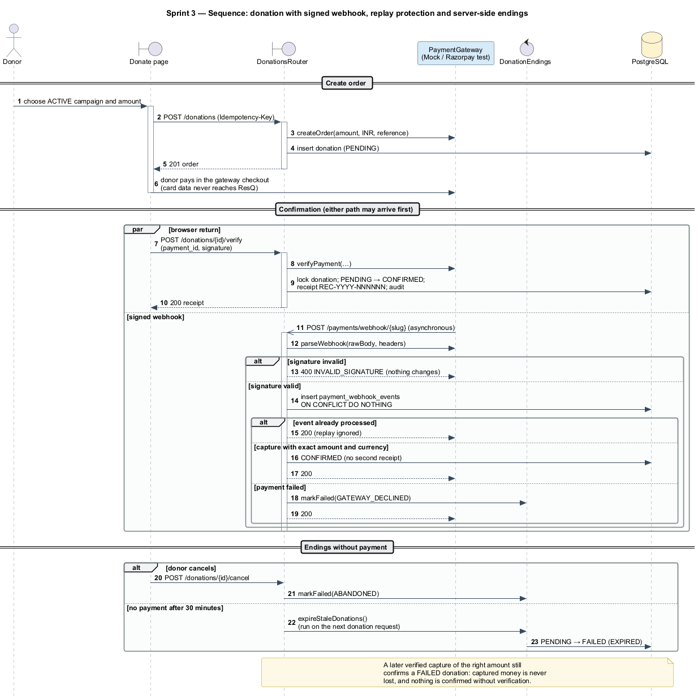

# ResQ: Sprint Details (Sprint 0 to Sprint 3)

Group 30. The project ran as **Sprint 0** (everything before the first planned sprint) followed by **three one-week sprints**, each followed by a short **buffer** for stabilisation, merges and catching up. Task IDs (S1-01 … S3-18) match the team's sprint plan, [`sprints/Sprint-Member-Wise.pdf`](../project/sprints/Sprint-Member-Wise.pdf). Story IDs match [03-user-stories-backlog.md](03-user-stories-backlog.md). Each sprint section ends with its **class diagram** and **sequence diagram**.

## 1. Timeline

| Period | Dates (2026) | Goal | Commits (non-merge) | Merges |
|---|---|---|---|---|
| **Sprint 0** | 11 Sep – 29 Oct | Requirements, design, repository and delivery pipeline, staff identity and the DM core | 113 | 25 |
| **Sprint 1** | 30 Oct – 4 Nov | *Real core loop*: citizen reports → dispatcher verifies → public Gujarat map | 83 | 41 |
| Buffer 1 | 5 – 6 Nov | Stabilise Sprint 1, smoke tests on staging, invitations | 21 | 11 |
| **Sprint 2** | 7 – 12 Nov | *Run the response and integrate AI*: field teams, recommendations, ingestion, donations, AI | 46 | 12 |
| Buffer 2 | 13 – 14 Nov | Catch-up merges (largest merge day), photo storage decision | 87 | 22 |
| **Sprint 3** | 15 – 22 Nov | *Harden and release*: payments hardening, sessions, admin console, security review, load test, docs | 139 | 41 |
| Buffer 3 | 23 Nov – 3 Dec | Testing documents, rehearsals, release tag, submission | — | — |

Commit counts are from `git log` for each date range. Some Sprint 1 tasks began before 30 Oct; for example, the payments interface and the public routers are dated 28–29 Oct. They are counted in the sprint whose task they belong to.

## 2. Milestones

| Milestone | Date | Evidence |
|---|---|---|
| SRS (revised) baselined | 29 Sep | `FR_NFR_API_routes.pdf` (mid-evaluation) |
| CI/CD and schema in place | 29 Sep | `ci.yml`, first migrations |
| Mid-evaluation submission | Oct | SRS, stories workbook v5, Report 1, ER diagram |
| Staff MFA and DM workspace merged | 15–17 Oct | PR #37 and follow-ups |
| Core loop on real backend (Sprint 1 gate) | 4 Nov | `scripts/smoke.py` (register → report → verify → public map) |
| Field loop and AI integrated (Sprint 2 gate) | 12 Nov | Field and dispatch transitions, `/triage` behind guardrails |
| Staging plus production with smoke gate | 15 Nov | Defects D-01 to D-03 closed |
| Hardened release candidate (Sprint 3) | 22 Nov | Payment endings, sessions, admin console, load test p95 633 ms |
| Final submission | 3 Dec | This document set |

---

## 3. Sprint 0: foundations (11 Sep – 29 Oct)

**Goal.** Turn the idea into an agreed scope. Build the database, the delivery pipeline and the staff-side core, so that the sprints could focus on the end-to-end loop.

**Work done**

| Area | What was delivered | Who |
|---|---|---|
| Requirements | Final SRS (Revised): 49 FRs, 47 NFRs, 26 error cases, API routes. User stories workbook v5: 119 stories, 16 epics, traceability and conflict register. Requirements and agile planning report | Shlok (SRS), whole team (stories, report) |
| Data design | BCNF schema for Neon PostgreSQL + PostGIS; migration runner; `01_schema.sql`, `02_dm_module.sql` (permissions); ER diagram | Tanishq, Siddh |
| Delivery | Repository, CONTRIBUTING fork guide, Docker and compose, `ci.yml` (lint, tests on PostGIS, gitleaks, bandit, pip-audit, Trivy), `cd.yml` (GHCR, Render, Vercel) | Siddh |
| Staff identity | Password + TOTP MFA, JWT with `token_version` revocation, lockout, staff management, role routing | Zalak, Shlok |
| DM core | Incident verification and priority, rule-based duplicates, dispatch lifecycle with row-locked resources, auto-escalation, AI provider boundary, aid and campaign tables, DM workspace pages and live map | Shlok, Nisarg |
| UI | Whitish theme, navigation, Leaflet map with OSM and Nominatim; citizen dashboard prototype on a SQLite stand-in, later retired | Tanishq, Janvi |
| Gujarat data | Geofence and spatial boundaries (`03`, `04` migrations), recommendation engine prototype, sprint plan | Siddh, Nisarg |
| QA groundwork | Smoke-test script, seed reset with a safety guard, testing guide | Dhruv |
| ML groundwork | Image classifier reproduction (ConvNeXt-Tiny, 7 classes) | Dhruvil |

**Stories delivered:** US-D01, D02, D03, D04, D05, D08, D10, D11, D12, D14 (partly), D17 (partly), D19, D30, D31, D35, D36, D38, US-A01, A03, A09 (partly), A17, A20, A22, A25, US-X01 (partly), X08, X10.

**Retrospective**

- *Went well:* the SRS and the workbook gave a clear, traceable scope. CI was in place from the first week.
- *To improve:* two parallel prototypes, a localStorage/SQLite citizen module and the real DM backend, had to be reconciled. The legacy code was removed on 25 Oct (`b12ef62`). That cleanup also removed the mid-evaluation documents from the repository. They remain in git history, and their corrected successors are listed in [12-requirements-planning-report-v2.md §0](12-requirements-planning-report-v2.md#0-mid-evaluation-baseline-and-what-replaced-it).

**Class diagram: Sprint 0**

**Sequence diagram: Sprint 0 (staff sign-in with MFA, then a verification)**

---

## 4. Sprint 1: real core loop (30 Oct – 4 Nov)

**Goal.** A citizen registers and reports. A dispatcher verifies. The verified incident appears on the public Gujarat map. All of it runs on the real backend. The AI dataset, the ingestion framework and the payments foundation start in parallel.

**Sprint backlog**

| Task | Description | Owner (support) | Status |
|---|---|---|---|
| S1-01 | Secrets rotation, repo hygiene, README, API contract | Siddh (Dhruv) | Done |
| S1-02 | Migrations 03 and 04, Gujarat seed | Siddh (Nisarg, Shlok, Zalak) | Done |
| S1-03 | Citizen register and login API | Zalak (Dhruv) | Done |
| S1-04 | Citizen report API with Gujarat check, My reports | Zalak (Nisarg) | Done |
| S1-05 | Auth UI on the real backend | Janvi (Tanishq) | Done |
| S1-06 | Citizen report form and My reports; retire the SQLite stand-in | Janvi (Tanishq) | Done |
| S1-07 | Public verified-incidents API and Gujarat geofence | Nisarg (Siddh) | Done |
| S1-08 | Public Gujarat map, About, How-to | Tanishq (Janvi) | Done |
| S1-09 | Dispatcher console on real data; retire the mock | Tanishq (Zalak, Nisarg, Shlok) | Done |
| S1-10 | Text dataset design and labelling | Neeti (Dhruvil, Rudra) | **Partial**: 200 draft rows; target ≥ 600 not met |
| S1-11 | Team-recommendation rules and query | Nisarg | Done |
| S1-12 | Baselines and evaluation harness | Neeti (Dhruvil) | Partial: harness done; frozen split missing |
| S1-13 | AI service skeleton `/triage`, `/health` on the rules baseline | Rudra (Neeti, Dhruvil, Siddh) | Done |
| S1-14 | Image classifier weights and class mapping | Dhruvil | Done (model); hosting is S3-08 |
| S1-15 | Ingestion framework, adapter, fixtures, source memo | Rudra (Siddh) | Done |
| S1-16 | Payments foundation: `PaymentGateway`, mock, campaigns API, create order | Shlok (Siddh) | Done |
| S1-17 | DB test harness, smoke script, seed reset | Dhruv | Done |
| S1-18 | CI additions and staging deploy | Siddh (Dhruv) | Done |
| S1-19 | Integration gate (Day 3 demo, Day 5 on staging) | Siddh (Dhruv) | Done |

**Stories delivered:** US-N01, N02, N04, N05, N06, N08, N19, N26, N30, N33 (partly), N37, US-D09, D20, D26, US-A13 (partly), A33, US-X09.

**Review (4 Nov):** the core loop ran end to end on staging through `scripts/smoke.py`.

**Retrospective**

- *Went well:* the shared migration and seed work on Day 1 unblocked four people.
- *To improve:* the text dataset depended on manual labelling and slipped. It became the AI critical path for the rest of the project.

**Buffer 1 (5 – 6 Nov):**

- Account invitations and password reset (migration 09).
- Staging verification report and cold-start polling (Dhruv).
- Sprint 1 fixes.

**Class diagram: Sprint 1**

**Sequence diagram: Sprint 1 (core loop)**

---

## 5. Sprint 2: run the response and integrate AI (7 – 12 Nov)

**Goal.** Team recommendation and confirmed assignment; the field-team flow; the AI service integrated into triage; duplicate scoring; ingestion every 15 minutes; a donation sandbox.

**Sprint backlog**

| Task | Description | Owner (support) | Status |
|---|---|---|---|
| S2-01 | Field-team role and endpoints; shared dispatch-transition refactor | Nisarg (Shlok, Dhruv) | Done |
| S2-02 | Team-recommendation endpoint and team-request decisions | Nisarg (Siddh) | Done |
| S2-03 | Dispatcher UI: recommendations, assignment, requests, resolution | Tanishq (Nisarg) | Done |
| S2-04 | Field-team dashboards, alerts map layer | Janvi (Tanishq) | Done |
| S2-05 | Train and select the text model | Neeti (Dhruvil) | **Not met**: macro-F1 target 0.75; rules baseline kept |
| S2-06 | `/triage` integration, priority rules, guardrail tests | Neeti (Siddh, Tanishq, Dhruvil, Rudra) | Done for the non-ML part (#164); trained artifact missing |
| S2-07 | Duplicate grouping v2 (text similarity) | Dhruvil (Zalak, Neeti) | Partial: `rules+text` score; weights not tuned |
| S2-08 | Optional LLM adapter, off by default | Zalak (Siddh) | Done |
| S2-09 | SACHET adapter, replay source, scheduler, ingestion health | Rudra (Neeti, Siddh) | Done |
| S2-10 | Signal promotion API and signals queue | Shlok (Rudra, Tanishq) | Done |
| S2-11 | Public alerts API and map layer | Janvi (Rudra) | Done |
| S2-12 | Donations end to end: verify, webhook, receipts, screens | Shlok (Janvi, Siddh, Dhruv) | Done |
| S2-13 | Citizen information response, polish, abuse limits | Zalak (Janvi) | Done |
| S2-14 | Backend test hardening, field-user fixtures | Dhruv (Zalak, Nisarg) | Done |
| S2-15 | Integration gate | Siddh (Dhruv) | Done |
| S2-16 | Staging redeploy on every merge, post-deploy smoke, ingestion cron | Siddh (Dhruv) | Done |

**Stories delivered:** US-N03, N09, N10 (partly), N12, N16, N17 (partly), N25, N28, N31, N32, US-D06, D07, D13, D15, D16, D23, D29, D32, D33, D34, D42, D43, D44, D48, US-A24 (partly), A28, US-X02, X03, X04, X07 (partly), X11, US-F01 – F05.

**Review (12 Nov):** the field loop works end to end: dispatch, acknowledge, EN_ROUTE, ON_SCENE, complete. Triage advice is shown and decided on. SACHET alerts reach the map.

**Retrospective**

- *Went well:* the shared `run_dispatch_transition` refactor on Day 1 meant the staff and field endpoints share one state machine.
- *To improve:*
  - The AI model target was not reached; the system stays on a transparent rules baseline.
  - Many pull requests waited for the buffer. 13–14 Nov had the most merges of the project.

**Buffer 2 (13 – 14 Nov):**

- Catch-up merges.
- Photos stored in the database (`evidence_blobs`, migration 11).
- Mock gateway split out.
- Duplicate text similarity.
- Server-side donation endings started.

**Class diagram: Sprint 2**

**Sequence diagram: Sprint 2 (recommend, dispatch, field acknowledgement and completion)**

---

## 6. Sprint 3: harden and release (15 – 22 Nov)

**Goal.** End-to-end scenario, security review, polish, AI error analysis, deployment, documentation, rehearsals and a tagged release candidate.

**Sprint backlog**

| Task | Description | Owner (support) | Status |
|---|---|---|---|
| S3-01 | Automated end-to-end cyclone scenario (`scripts/scenario_run.py`) | Dhruv (Zalak, Nisarg) | Done (runner); repeated runs on staging scheduled for Buffer 3 |
| S3-02 | Security, RBAC and privacy review; scans | Siddh (Dhruv, Zalak, Shlok) | Done ([security-review.md](../quality/security-review.md)) |
| S3-03 | Frontend polish, accessibility, mobile | Janvi (Tanishq) | Done |
| S3-04 | Final About, How-to and Gujarat safety content | Tanishq (Nisarg) | Done |
| S3-05 | AI error analysis, thresholds, model card | Neeti (Dhruvil) | Partial: model card part A (rules baseline) |
| S3-06 | AI-versus-human analytics | Zalak (Tanishq, Neeti) | Done |
| S3-07 | LLM evaluation and keep-or-drop decision | Neeti (Zalak, Dhruvil) | Partial: decision recorded (LLM stays off); numbers wait for S2-05 |
| S3-08 | Photo-analyse demo path | Dhruvil (Tanishq) | Partial: classifiers merged (PR #186, 20 Nov), hosted on Render with weights on Hugging Face; `AI_IMAGE_SERVICE_URL` not set in production |
| S3-09 | Ingestion soak test and health UI | Rudra (Siddh) | Done (D-10: 0 duplicate alerts) |
| S3-10 | Social source final and signal sanitisation | Rudra | Done (live sources off by default) |
| S3-11 | Payments hardening: failure paths, receipts, tamper tests | Shlok (Dhruv, Janvi) | Done (migrations 12–13) |
| S3-12 | Production-like deployment, backups, rollback | Siddh (Shlok, Dhruv) | Done; rollback drill part B open |
| S3-13 | Performance smoke and load test | Nisarg (Shlok) | Done (p95 633 ms) |
| S3-14 | Team-recommendation tuning, EXPLAIN and indexes | Nisarg | Done |
| S3-15 | Demo script and rehearsals | Siddh (all) | Script done; rehearsal log in Buffer 3 |
| S3-16 | Final report and documentation | Zalak (all) | Draft done; sign-offs open |
| S3-17 | Defect triage | Dhruv (Siddh) | Done ([defect-list.md](../quality/defect-list.md)) |
| S3-18 | Release tags `v1.0.0-rc1`, `v1.0.0` | Siddh | Open (Buffer 3) |

**Added during the sprint (outside the plan):**

- Administration console (`/admin`: accounts, audit, system).
- Refresh-token sessions with per-role idle and absolute limits (migration 15).
- Shelters (16).
- Incident notes (17).
- Agency directory.
- CSV exports.
- Google sign-in.
- Hindi and Gujarati citizen UI.
- Earthquake alerts removed (18) and unused schema dropped (19).

**Stories delivered:** US-N07, N11, N13, N20 (partly), N22, N23 (partly), N24, N27 (partly), N29, N34, N36 (partly), N38, N39, US-D18, D21, D22, D24, D25 (partly), D27 (partly), D28, D37, D39 (partly), D40, D41 (partly), D45, D46, D47, D49, US-A02, A04, A06 (partly), A07, A08 (partly), A10 (partly), A12 (partly), A18 (partly), A21 (partly), A23 (partly), A26, A27 (partly), A29 – A31 (partly), A34, US-X05, X06.

**Retrospective**

- *Went well:*
  - Every payment path now ends on the server.
  - CD cannot report a skipped deployment as green (D-01).
  - Staging is smoke-tested before production.
- *To improve:*
  - Author sign-offs, rehearsals and release tags were left to the last buffer.
  - The trained text model and the hosted image service did not reach production.

**Class diagram: Sprint 3**

**Sequence diagram: Sprint 3 (donation with signed webhook and server-side endings)**

---

## 7. Buffer 3 (23 Nov – 3 Dec)

The last buffer is reserved for the work that closes the project:

- the testing documents (unit and white-box, system and black-box, GUI, mutation, non-functional);
- two demo rehearsals recorded in [demo-script.md](../project/demo-script.md);
- the rollback drill on staging and a production backup before release;
- the release tags `v1.0.0-rc1` and `v1.0.0`;
- the demo video and the submission archive.

## 8. Velocity

Measured in stories delivered (Done or Partial) per sprint: Sprint 0 – 27, Sprint 1 – 17, Sprint 2 – 36, Sprint 3 – 46. One more Partial story (US-A05, configuration through environment variables) has no sprint. Sprint 1 was the shortest effective sprint because of shared Day-1 dependencies. Sprints 2 and 3 grew as the platform layers (migrations, auth, CI) were already in place.
