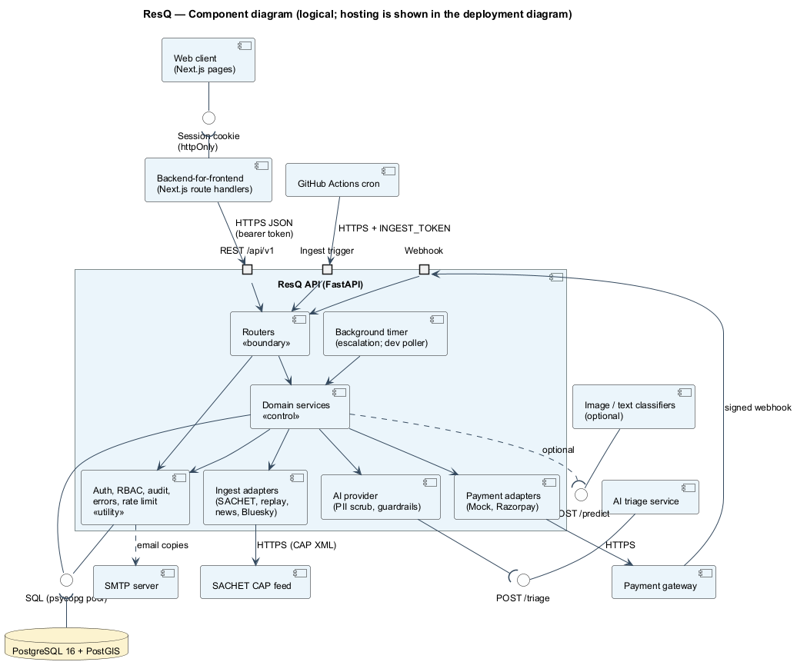
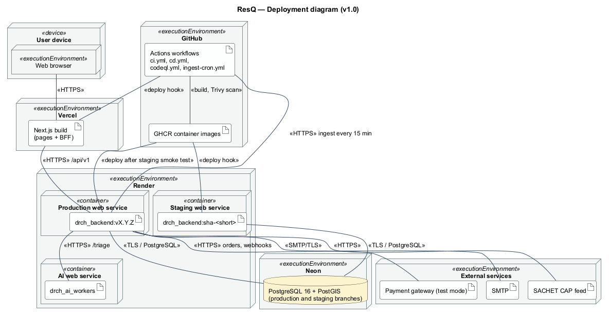

# ResQ: System Design (combined for Sprints 0–3)

Group 30. This document describes the design of the whole system as released (v1.0), combining what each sprint built. The class and sequence diagrams for each sprint are in [04-sprint-details.md](04-sprint-details.md); the object-level design is in [06-object-design.md](06-object-design.md). The detailed references stay in `docs/architecture/`: [ARCHITECTURE.md](../architecture/ARCHITECTURE.md), [api_contracts.md](../architecture/api_contracts.md), [er-diagram.md](../architecture/er-diagram.md) and [env-variables.md](../architecture/env-variables.md).

## 1. Design goals

| Goal | Design decision |
|---|---|
| Human in the loop | AI output is stored apart from the incident (`ai_recommendations`) and only advises. Every decision is an explicit, audited human action. |
| Accountability | Every state change writes an append-only, SHA-256 hash-chained `audit_logs` row in the same transaction. |
| Correctness under concurrency | Incidents and resources carry an optimistic `version`. Allocation takes `SELECT … FOR UPDATE` row locks. Background jobs use PostgreSQL advisory locks. |
| Privacy | The public API exposes no reporter data and rounds coordinates to 4 decimal places. PII is removed before any AI call. Photos are served only through authorised endpoints. |
| No false success | Payments, dispatches and deliveries change state only on a confirmation event. External failures become labelled states. |
| Free-tier deployability | Stateless API, one database, no cache or queue service. Hot paths take 1–3 database round trips. |

## 2. Architecture style

ResQ is a **three-tier, layered client–server system** with a **backend-for-frontend (BFF)**:

1. **Presentation.** The Next.js 16 App Router serves the public, citizen, DM, field and admin areas. Server route handlers (`/api/session`, `/api/citizen`, `/api/dm`, `/api/field`, `/api/admin`) form the BFF. They read the httpOnly session cookie, attach the bearer token, reject cross-site writes and forward requests to the backend. The browser never holds a token in JavaScript.
2. **Application.** A FastAPI backend under `/api/v1`:
   - **Routers** handle the HTTP contract, validation and the RBAC dependency.
   - **Services** hold the domain logic.
   - **Core modules** provide audit, auth, errors, geo, rate limiting and uploads.
   - **Payments and ingestion adapters** wrap external systems.
3. **Data.** Neon PostgreSQL 16 with PostGIS, with forward-only SQL migrations `01`–`19`.

Separately deployed helper services: the AI triage service (`ai-workers`, FastAPI) and the optional image and text classifiers. The backend reaches them only over HTTP through configured URLs, so the core keeps working when they are down.

Source: [diagrams/component.puml](diagrams/component.puml)

## 3. Subsystem decomposition

| Subsystem | Responsibility | Main modules | Sprint |
|---|---|---|---|
| Identity & access | Registration, staff sign-in with TOTP, Google sign-in, invitations, refresh-token sessions, RBAC with five DM permissions | `routers/auth.py`, `auth.py`, `security.py`, `services/sessions.py` | S0, S1, S3 |
| Citizen reporting | Reports with idempotency, Gujarat geofence, photos, timeline, information response, withdrawal, notifications | `routers/citizen.py`, `geo.py`, `uploads.py`, `common.notify` | S1–S3 |
| Incident operations | Verification, priority, duplicates, resolution, closure and reopen, notes, exports | `routers/dm/incidents.py`, `services/incidents.py`, `services/duplicate_similarity.py` | S0, S3 |
| Dispatch & field | Dispatch lifecycle, resource reservation, escalation, field acknowledgement and progress, team requests, recommendations | `routers/dm/dispatches.py`, `routers/field.py`, `services/dispatch.py`, `services/resources.py`, `services/recommendations.py` | S0–S2 |
| AI advisory | PII scrub, provider call, guardrails, human decision record; optional photo analysis | `services/ai_provider.py`, `routers/dm/ai.py`, `ai-workers/` | S0–S2 |
| Ingestion & signals | Adapters (SACHET, replay, Google News, Bluesky), scheduler, run log, signals queue, related-signal matching, promotion | `services/ingestion.py`, `services/ingest/*`, `services/signal_matching.py`, `routers/dm/signals.py`, `routers/internal.py` | S1–S3 |
| Donations & aid | Campaigns, orders, signature verification, webhook, receipts, endings; DM aid needs and allocations | `routers/donations.py`, `payments/*`, `services/donation_endings.py`, `routers/dm/aid.py` | S1–S3 |
| Public communication | Public map API, alerts, shelters, updates, versioned safety content | `routers/public.py`, `routers/dm/content.py`, `routers/dm/shelters.py` | S1–S3 |
| Administration & audit | Accounts, permissions, audit search and chain verification, system status | `routers/admin.py`, `audit.py`, `cli.py` | S0, S3 |

## 4. Hardware and software mapping (deployment)

| Node | Runs | Notes |
|---|---|---|
| Vercel | Next.js frontend and BFF | https://it-314-software-project.vercel.app/ |
| Render, production | `drch_backend` image (FastAPI and Uvicorn) | Deployed only after staging passes the smoke test |
| Render, staging | `drch-backend-latest` | Every merge is deployed here first, and `scripts/smoke.py` runs against it |
| Render, AI | `drch_ai_workers` (`/triage`) | Advisory only |
| Neon | PostgreSQL 16 + PostGIS | A branch is taken before each release, and `pg_dump` backups are made |
| GitHub | CI (`ci.yml`, `codeql.yml`), CD (`cd.yml`), `ingest-cron.yml`, GHCR images | Images are tagged `latest`, `sha-<short>` and `vX.Y.Z` |

**Delivery pipeline.** A pull request must pass the Quality Gate: gitleaks, ruff, bandit, pip-audit and npm audit, backend tests on a PostGIS 16 container, Playwright e2e, and a container build scanned by Trivy. A merge to `main` then:

1. publishes the images;
2. deploys to staging;
3. waits until staging reports the new `GIT_SHA`;
4. runs the smoke test;
5. deploys to production.

A final job fails the run if any expected deployment was skipped. A release or rollback is done by pointing Render at an image tag.

## 5. Persistent data management

- **Database:** one PostgreSQL 16 database with PostGIS. It has **35 tables and 56 foreign keys**; the generated ER diagram is in [er-diagram.md](../architecture/er-diagram.md). The main groups:
  - identity (`roles`, `users`, `user_auth`, `staff_permissions`, `refresh_tokens`, `field_team_members`);
  - incidents (`incidents`, `incident_status_history`, `evidence_files`, `evidence_blobs`, `incident_notes`, `ai_recommendations`);
  - operations (`resources`, `dispatch_orders`, `resource_assignments`, `dispatch_progress`, `team_requests`, `agencies`, `agency_messages`, `shelters`);
  - ingestion (`external_alerts`, `source_signals`, `ingest_runs`, `administrative_boundaries`);
  - contributions (`donation_campaigns`, `donations`, `payment_webhook_events`, `aid_needs`, `aid_contributions`);
  - communication (`public_updates`, `safety_content`, `notifications`);
  - governance (`audit_logs`).
- **Integrity rules in the schema:**
  - enumerated types for every state;
  - CHECK constraints (for example, VERIFIED, DISPATCHED and RESOLVED require `verified_priority`; a receipt only on CONFIRMED donations);
  - unique idempotency keys;
  - an audit trigger that computes the hash chain and blocks UPDATE and DELETE.
- **Migrations:** forward-only SQL files applied by `python -m app.migrate` under an advisory lock, also at startup. Reference data is seeded everywhere; demo data only in development.
- **Files:** citizen photos are stored in `evidence_blobs` (at most 5 × 5 MB per report). They therefore share the database's backups and access rules. Moving them to Cloudinary is planned.
- **Spatial:** Gujarat state and district polygons are kept in `administrative_boundaries` and cached in RAM for containment checks; Nominatim is the fallback for district lookup.

## 6. Access control and security

| Mechanism | Design |
|---|---|
| Roles | `NORMAL_USER`, `DISASTER_MGMT`, `APP_MGMT`, `FIELD_TEAM` |
| DM permissions | `PUBLISHER`, `MODERATOR`, `CLOSURE`, `DISPATCH`, `SUPERVISOR`, granted separately (`staff_permissions`) |
| Authentication | Argon2id passwords. TOTP MFA for staff, with the secret stored encrypted. Short-lived access JWT plus a rotating refresh token per family, with per-role idle and absolute expiry. `token_version` revokes all sessions at once. Lockout after 5 failures for 15 minutes. |
| Authorisation | The principal (role, status, lock, `token_version`, permissions) is loaded from the database on **every** request in one statement and never cached. Router dependencies are `require_citizen`, `require_dm`, `require_permission(p)`, `require_field` and `require_admin`. Administrators have no operational access. |
| Route protection | Three layers: `proxy.ts` (no cookie → `/login`), a workspace layout that checks the role, and the backend check on every call. |
| Input safety | Pydantic validation; uploads checked by their bytes with metadata removed; ingested text sanitised; no HTML rendering of user text; per-endpoint rate limits. |
| Secrets | Held only in the Render, Vercel and GitHub consoles. The repository lists only names ([env-variables.md](../architecture/env-variables.md)). |
| Audit | `audit.record()` in the same transaction as the change. `POST /admin/audit/verify` and `python -m app.cli verify-audit` re-compute the chain. |

## 7. Global control flow

- **Request-driven.** Each HTTP request runs in one database transaction (`with db.transaction() as conn:`). Read-only handlers use an autocommit connection.
- **Background timer in the backend process.** Every 60 seconds it runs `escalate_overdue()`. It also runs the boundary sync check and, when `INGESTION_WORKER_ENABLED` is on (the default only in development), an ingestion poller every `INGEST_INTERVAL_SECONDS` (default 900).
- **Lazy expiry.** Donations left unpaid for 30 minutes are moved to FAILED (EXPIRED) by `expire_stale_donations()` the next time donations are created, read or overseen. No separate job is needed.
- **External triggers.** In staging and production, ingestion is driven by GitHub `ingest-cron.yml`. Every 15 minutes it calls the token-guarded `POST /api/v1/internal/ingest/run`, which also wakes the sleeping free instance. Payment webhooks arrive at `POST /payments/webhook/{slug}`.
- **Idempotency** protects every retried command: report creation, dispatch creation, donation creation and webhook events.

## 8. Boundary conditions

| Condition | Behaviour |
|---|---|
| Start-up | Run migrations, load boundary polygons, start background workers. `/api/v1/health` reports the database, version and build `GIT_SHA`. |
| Cold start | Render sleeps after inactivity. The cron job keeps it warm, and the demo script opens `/health` first. |
| AI service down | Triage result `UNAVAILABLE`; manual triage. Photo analysis answers 503. |
| Gateway down | The donation stays PENDING and ends as EXPIRED after 30 minutes. Nothing is shown as confirmed. |
| Feed down | That ingestion run is FAILED with a safe message; other sources continue. Fallback alerts are labelled. |
| Concurrent edits | 409 `VERSION_CONFLICT`, or `RESOURCE_CONFLICT` when less quantity is left than requested; the client reloads. |
| Failure and rollback | Roll back by deploying a previous image tag. Restore the database from a Neon branch or `pg_dump` (restore guarded to `_restore` / `_test` databases). |

## 9. Key end-to-end behaviour

- [Activity: incident response from report to closure](diagrams/png/activity-incident-response.png)
- [Activity: ingestion run](diagrams/png/activity-ingestion.png)
- State machines: [incident](diagrams/png/state-incident.png), [dispatch](diagrams/png/state-dispatch.png), [donation](diagrams/png/state-donation.png), [signal, safety content and team request](diagrams/png/state-signal-content.png). These are explained in [07-design-diagrams.md](07-design-diagrams.md).

## 10. API overview

All routes sit under `/api/v1`, and every error has the form `{"error": {"code", "message", "details"}}`. The full contract is in [api_contracts.md](../architecture/api_contracts.md).

| Group | Prefix | Examples |
|---|---|---|
| Auth | `/auth` | register, login, mfa/verify, refresh, logout, google, invitations, forgot / reset password |
| Citizen | `/incidents`, `/me/*` | create report, my incidents, attachments, information-response, withdrawal-request, profile, notifications, account deletion, my donations |
| Public | `/public` | incidents, alerts, shelters, campaigns, safety-content, updates |
| DM | `/dm` | incidents (verification, priority, resolution, closure, reopen, duplicates, notes), dispatches, resources, team-recommendations, team-requests, signals, ai-triage, photo-analyse, campaigns, aid, needs, public-updates, safety-content, moderation, analytics, map, shelters, agencies, staff, ingestion, exports |
| Field | `/field` | me, assignments, acknowledgement, rejection, progress, team-requests, completion |
| Admin | `/admin` | accounts (disable, enable, sign-out, permissions, bulk, export), audit, audit/verify, system |
| Payments | `/donations`, `/payments/webhook/{slug}` | create, verify, cancel, sandbox-payment, webhook |
| Internal | `/internal/ingest/run` | token-guarded ingestion trigger |
