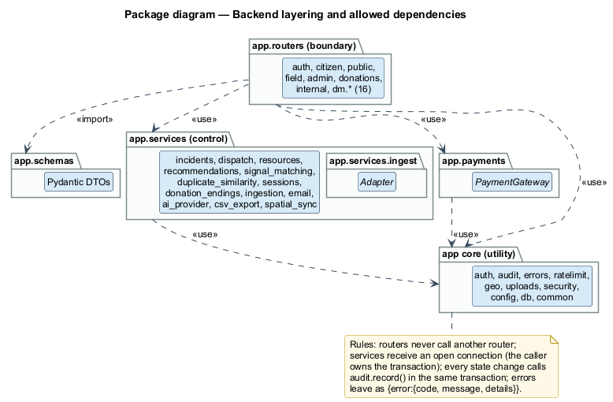

# ResQ: Object Design

Group 30. The [system design](05-system-design.md) splits ResQ into subsystems. This document refines them into classes, interfaces, contracts and design patterns. Diagrams use UML 2.5.1 class notation with Entity–Control–Boundary stereotypes. A Python module of functions is shown as a `«utility»` class, and the conventions are listed in [07-design-diagrams.md §2](07-design-diagrams.md#2-notation-and-conventions).

## 1. Package structure and layering rules



| Layer | Package | May depend on | Must not |
|---|---|---|---|
| HTTP boundary | `app.routers`, `app.routers.dm` | schemas, services, payments, core | call another router; hold business rules shared by two routers |
| DTOs | `app.schemas` and Pydantic models in routers | — | access the database |
| Domain | `app.services`, `app.services.ingest` | core | import FastAPI request objects; open their own transactions when a caller passes `conn` |
| Integration | `app.payments`, `ai_provider`, ingest adapters | core | let a provider error escape as a 500 |
| Core | `auth`, `audit`, `errors`, `geo`, `ratelimit`, `uploads`, `security`, `config`, `db`, `common` | database driver | — |

The frontend follows the same idea:

- `app/*` pages compose `components/*`.
- Components call `services/*` API adapters, or the `lib/api.ts` client.
- Those always reach the backend through the BFF route handlers in `app/api/*`.
- Session state comes from one `SessionProvider` (`useSession()`).

## 2. Key classes and responsibilities

### 2.1 Identity and access

| Class / module | Responsibility | Key operations |
|---|---|---|
| `Principal` (`auth.py`) | The authenticated caller as loaded for this request: `user_id`, `role`, `permissions`, `mfa_verified`, `ip` | `has(permission) → bool` |
| `FieldPrincipal` (`auth.py`) | A `Principal` restricted to the field team(s) the user belongs to | `resource_ids` |
| `auth` | Builds the principal from the bearer token and the database in one query; FastAPI dependencies for each role | `load_principal`, `require_citizen`, `require_dm`, `require_permission(p)`, `require_field`, `require_admin`, `require_inviter` |
| `security` | Cryptographic helpers | `hash_password`, `verify_password` (Argon2id), `issue_token`, `decode_token`, `encrypt_mfa_secret`, `verify_totp` |
| `sessions` | Refresh-token families with per-role idle and absolute limits | `start_session`, `rotate`, `revoke_all`, `limits_for(role)` |

### 2.2 Incident and dispatch domain

| Class / module | Responsibility | Key operations |
|---|---|---|
| `incidents` service | Incident state machine and optimistic concurrency | `TRANSITIONS`, `lock_incident`, `check_version`, `ensure_open`, `update_incident`, `open_dependencies`, `reopen_target` |
| `dispatch` service | Dispatch state machine shared by the DM and field routers | `DISPATCH_TRANSITIONS`, `lock_dispatch`, `apply_acknowledgement`, `apply_rejection`, `apply_progress`, `apply_completion`, `apply_failure`, `run_dispatch_transition`, `escalate`, `escalate_overdue` |
| `resources` service | Atomic reservation and release of resources | `reserve`, `release`, `release_all_for_dispatch`, `derive_status` |
| `recommendations` service | Rank available teams for an incident | `get_required_capabilities`, `recommend_candidate_teams`, `score_and_rank_teams`, `get_recommended_teams → list[RecommendedTeam]` |
| `RecommendedTeam` (DTO) | One ranked team, with its reasons | `distance_km`, `matched_capabilities`, `match_percentage`, `rank`, `reasons` |
| `duplicate_similarity` | Advisory duplicate score | `text_similarity` (character trigrams), `combined_score`, `score_candidates` |

### 2.3 AI boundary

```text
            «abstract» TriageProvider
            + triage(payload) : TriageOutcome
                 ▲                       ▲
   UnavailableProvider          HttpTriageProvider
   (always UNAVAILABLE)         (POST AI_TRIAGE_URL/triage)

ai_provider.get_provider()   chooses the implementation from configuration
ai_provider.scrub_pii(v)     removes emails, phone numbers, id numbers before sending
ai_provider.apply_guardrails(raw) → TriageOutcome
      invalid shape → UNSAFE_OUTPUT; unsupported scenario → out of scope;
      confidence < AI_LOW_CONFIDENCE_THRESHOLD → LOW_CONFIDENCE
```

`TriageOutcome` holds `status`, `model_name`, `suggested_scenario`, `suggested_priority`, `confidence`, `uncertainty_note` and `factors`. It is stored in `ai_recommendations` and never written into `incidents`.

### 2.4 Payments

```text
«abstract» PaymentGateway                     «dataclass» Order
  name, slug, is_sandbox, checkout_key          order_id, amount, currency, gateway_name, is_sandbox, status
  + create_order(amount, currency, reference) : Order
  + verify_payment(...) : Verification        «dataclass» Verification
  + parse_webhook(raw_body, headers) : WebhookEvent   verified, order_id, payment_id, error_message
        ▲                    ▲                «dataclass» WebhookEvent
   MockGateway        RazorpayGateway           event_id, event_type, order_id, payment_id, amount, currency
   (sandbox only)     (HMAC-SHA256)             + is_capture, + is_failure
```

`payments.get_gateway()` returns the configured gateway. `payment_config_problems()` refuses a sandbox gateway when `APP_ENV=production`. `donation_endings.mark_failed(conn, row, reason)` and `expire_stale_donations(conn)` own the FAILED transitions.

### 2.5 Ingestion

```text
«abstract» Adapter (services/ingest/base.py)
  name; + fetch() → items
     ▲            ▲                  ▲                  ▲
 SachetAdapter  ReplaySignalAdapter  GoogleNewsAdapter  BlueskySearchAdapter
 (CAP alerts)   (team fixture)       (off by default)   (off by default)

ingestion.run_ingestion(source="ALL")
  → _ingestion_run_lock()  (pg advisory lock)
  → for each enabled adapter: _run_adapter → _store_alerts / _store_signals → IngestRunResult
signals.sanitise_signal_text, detect_language, mentions_hazard, locate_gujarat_text, stable_uid
signal_matching.find_related_signals(conn, signal_id) → groups with score and explanation
```

## 3. Interface contracts (pre- and post-conditions)

The contracts are written in OCL style for the operations that carry the domain rules. `self` is the row being changed.

```text
context incidents::update_incident(conn, principal, row, *, action, rationale, to_status, allow_any_transition, **fields)
  pre:  row is locked FOR UPDATE in conn
  pre:  fields ⊆ _SETTABLE columns
  pre:  to_status = null or allow_any_transition (close / reopen) or to_status ∈ TRANSITIONS[row.status],
        else raises 409 INVALID_TRANSITION
  pre:  to_status ∈ {VERIFIED, DISPATCHED, RESOLVED} implies a verified_priority is set (database CHECK)
  post: incidents.version = row.version@pre + 1
  post: to_status <> row.status@pre or to_status = NEEDS_INFORMATION implies one new incident_status_history row
  post: exactly one audit_logs row with before and after snapshots
  (the calling router then sends the reporter notification with common.notify in the same transaction)

context incidents::check_version(row, expected)
  pre:  true
  post: expected = null or expected = row.version, else raises 409 VERSION_CONFLICT

context resources::reserve(conn, principal, resource_id, dispatch, quantity)
  pre:  quantity > 0 and dispatch.status = REQUESTED
  post: the resource row was locked FOR UPDATE before it was read
  post: result implies resource.quantity_available = quantity_available@pre - quantity >= 0
        and one resource_assignments row exists for (dispatch, resource)
  post: quantity_available@pre < quantity implies raises 409 RESOURCE_CONFLICT and nothing changes
  post: resource.status ∈ {UNAVAILABLE, MAINTENANCE} implies raises 409 RESOURCE_UNAVAILABLE

context dispatch::run_dispatch_transition(dispatch_id, handler)
  pre:  handler is one of apply_acknowledgement | apply_rejection | apply_progress | apply_completion | apply_failure
  post: exactly one transaction; the dispatch row is locked; the new status ∈ DISPATCH_TRANSITIONS[old status]
  post: a report that contradicts the current status raises 409 and is audited (DISPATCH_*_CONFLICT), never applied
  post: new status ∈ {REJECTED, FAILED, COMPLETED} implies every open resource_assignment has released_at <> null

context donations::_apply_event(conn, gateway, event)
  pre:  the event signature was verified by gateway.parse_webhook
  pre:  _claim_event inserted (gateway_name, event_id) — a replay never reaches here
  post: event.is_capture and event.amount = donation.amount and event.currency = donation.currency
        and donation.status@pre ∈ {PENDING, FAILED}  implies  donation.status = CONFIRMED and receipt_no <> null
  post: amount or currency mismatch implies donation unchanged and DONATION_WEBHOOK_REJECTED audited
  post: event.is_failure and donation.status@pre = PENDING implies status = FAILED, failure_reason = GATEWAY_DECLINED

context ai_provider::apply_guardrails(raw) : TriageOutcome
  post: result.status ∈ {GENERATED, LOW_CONFIDENCE, UNAVAILABLE, UNSAFE_OUTPUT}
  post: result.scenario = null or result.scenario ∈ {cyclone, industrial_fire, urban_flooding}
  post: no incident row is read or written

context audit::record(conn, actor, action, entity_type, entity_id, ...)
  post: one audit_logs row in the caller's transaction; the trigger sets prev_hash to the last row_hash
        and row_hash = SHA-256(prev_hash ‖ row contents)
  inv (table audit_logs): UPDATE and DELETE are rejected by trigger
```

**Invariants enforced by the database** (from the migrations):

- `incidents`: `status ∈ {VERIFIED, DISPATCHED, RESOLVED} ⇒ verified_priority IS NOT NULL`; `status = CLOSED ⇒ closed_at IS NOT NULL`; `geom IS NOT NULL OR address_text IS NOT NULL`; `UNIQUE(reporter_id, idempotency_key)`.
- `donations`: `receipt_no IS NOT NULL ⇒ status = CONFIRMED`; `UNIQUE(gateway_name, gateway_txn_ref)`; the idempotency key is unique.
- `shelters`: `current_occupancy ≤ total_capacity`.
- `payment_webhook_events`: primary key `(gateway_name, event_id)`, so each event is applied at most once.

## 4. Design patterns used

| Pattern | Where | Why |
|---|---|---|
| **Strategy** | `PaymentGateway` (Mock, Razorpay); `TriageProvider` (Unavailable, Http); ingest `Adapter` subclasses | Swap the external provider by configuration without touching the routers; tests use the mock |
| **Adapter** | Each ingest source turns a foreign format (CAP XML, RSS, Bluesky JSON, JSONL replay) into one signal or alert shape | One storage path for all sources |
| **Template method** | `run_dispatch_transition(dispatch_id, handler)` owns the transaction, the lock and the error mapping; the `apply_*` handlers fill in the step | Staff and field endpoints share one dispatch state machine |
| **State (table-driven)** | `TRANSITIONS` and `DISPATCH_TRANSITIONS` dictionaries, plus database enums | Illegal transitions are rejected in one place (`INVALID_TRANSITION`, `DISPATCH_STATE_CONFLICT`) |
| **Facade** | `ai_provider` (scrub → call → guardrails); `geo` (cache, PostGIS, Nominatim) | Callers see one simple function |
| **Dependency injection** | FastAPI `Depends`: `CurrentUser`, `Publisher`, `Closer`, `Dispatcher`, `FieldUser`, `Page`, `rate_limit(...)` | Authorisation and paging are declared on each route |
| **Proxy (BFF)** | Next.js `/api/*` route handlers | Keeps the token in an httpOnly cookie; CSRF check; one origin for the browser |
| **Unit of work** | `with db.transaction() as conn:`; services accept `conn`; `db.after_commit(conn, fn)` | A state change, its history, its audit row and its notification commit together; emails are sent only after the commit |
| **Idempotent receiver** | `Idempotency-Key` on reports, dispatches and donations; `payment_webhook_events` | Safe retries, with no duplicates |
| **Observer (lightweight)** | `common.notify()` called on state changes, with an email copy after the commit | The citizen is informed without coupling routers to email |

## 5. Main data classes (persistent)

The complete set of entities is the generated ER diagram ([er-diagram.md](../architecture/er-diagram.md): 35 tables, 56 foreign keys). The core aggregates are:

| Aggregate root | Owned / related entities |
|---|---|
| `User` | `UserAuth` (1:1), `StaffPermission` (1:n), `RefreshToken` (1:n), `FieldTeamMember` (n:1 `Resource`) |
| `Incident` | `IncidentStatusHistory`, `EvidenceFile` + `EvidenceBlob`, `IncidentNote`, `AIRecommendation`, `DispatchOrder` (1:n); `canonical_incident_id` links duplicates |
| `DispatchOrder` | `ResourceAssignment`, `DispatchProgress`, `TeamRequest`, `AgencyMessage` |
| `Resource` | type TEAM, VEHICLE, SUPPLY or SUPPORT; capability JSON; current location |
| `DonationCampaign` | `Donation` → `PaymentWebhookEvent` |
| `AidNeed` | `AidContribution` (allocation, delivery status) |
| `SourceSignal` | promoted to an `Incident`; `IngestRun` logs each fetch; `ExternalAlert` for CAP warnings |
| `SafetyContent` / `PublicUpdate` | versioned, with author, approver and publisher recorded |
| `AuditLog` | append-only hash chain covering all of the above |

## 6. Frontend object design

| Unit | Responsibility |
|---|---|
| `SessionProvider` / `useSession()` | One shared session state (`authenticated`, `role`, `name`) from `GET /api/session`; quietly re-checks after navigation |
| `lib/api.ts` | Typed fetch wrapper: base URL, JSON, the standard error envelope turned into an `ApiError` |
| `services/*Api.ts` (`citizenApi`, `authApi`, `adminApi`, `invitationsApi`) | Thin adapters, one function per backend endpoint |
| `services/preTriage.ts`, `duplicateDetection.ts` | Client-side hints on the report form (advisory only) |
| `lib/session.ts` → `homeFor(role)` | Role → home route (`/citizen/dashboard`, `/dm`, `/field`, `/admin`) |
| `components/dm/LiveOperationsLayer` | Leaflet layers for incidents, teams and shelters |
| `components/ui.tsx`, `badges.tsx` | Design-system primitives and status badges |
| `lib/citizenI18n.ts`, `LanguageSelector` | English, Hindi and Gujarati strings for citizen screens |
| `use-action.ts` | Runs an async action with pending and error state for buttons |
