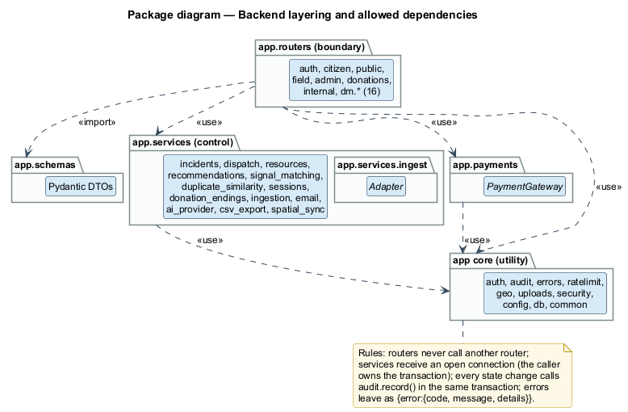
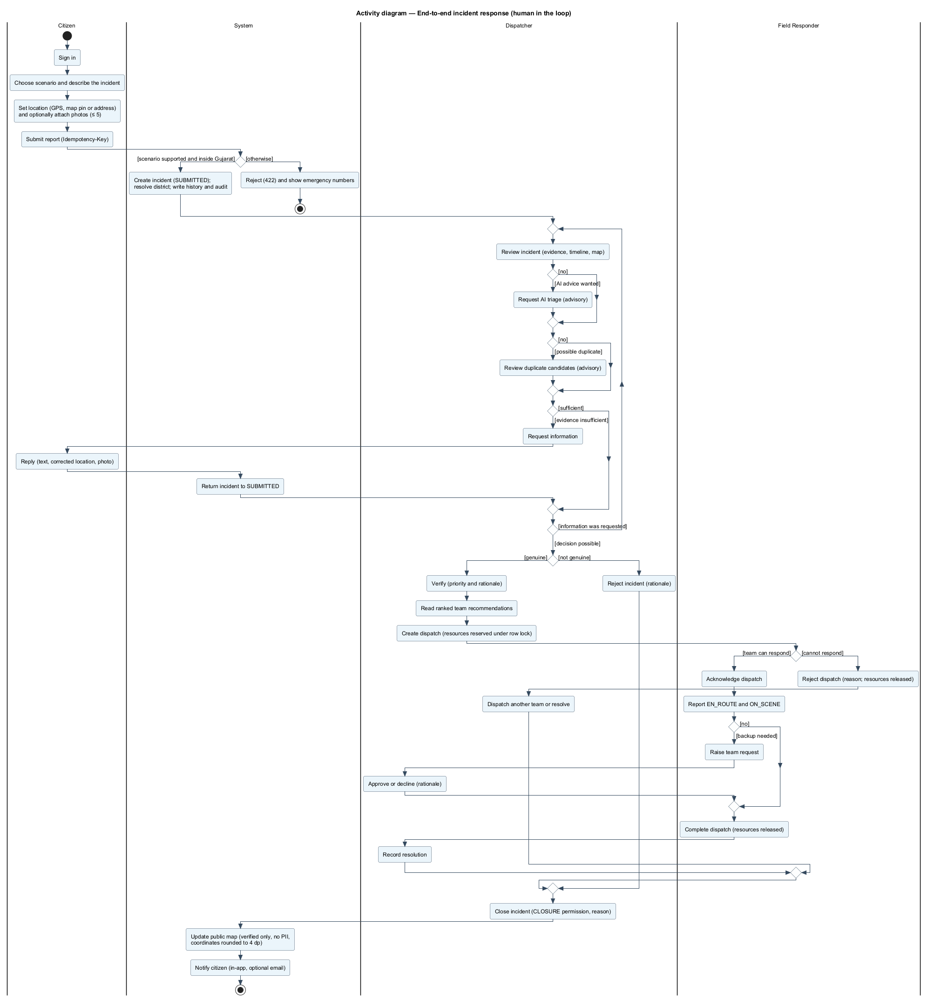
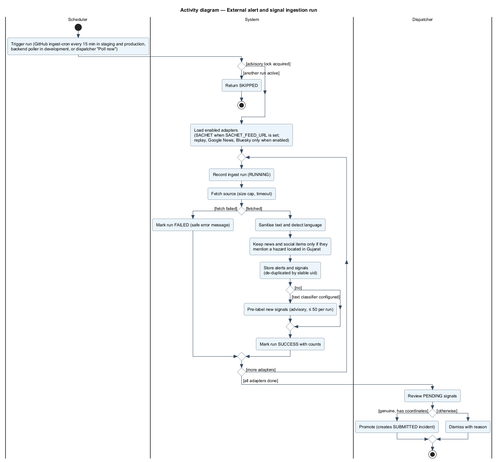
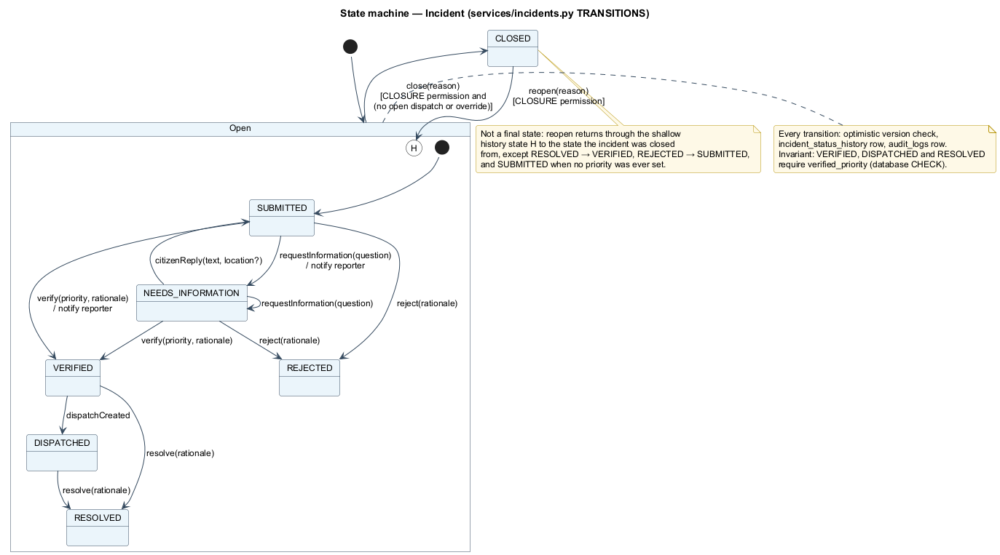
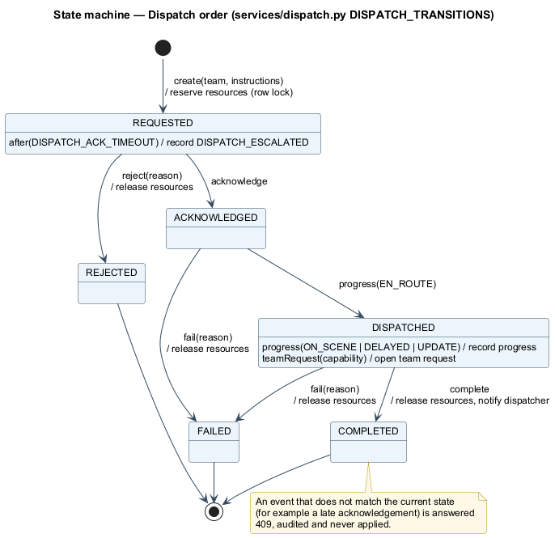
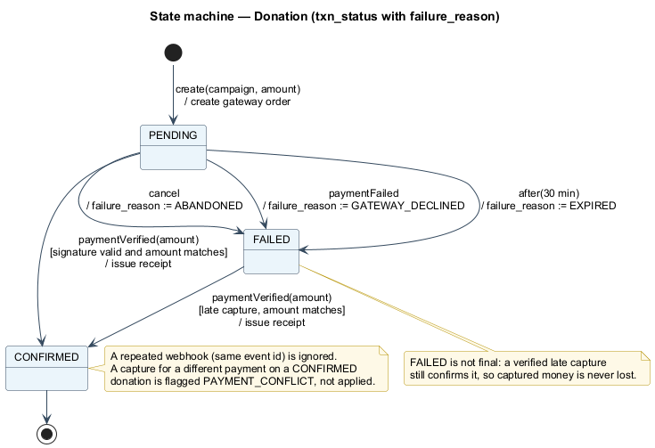
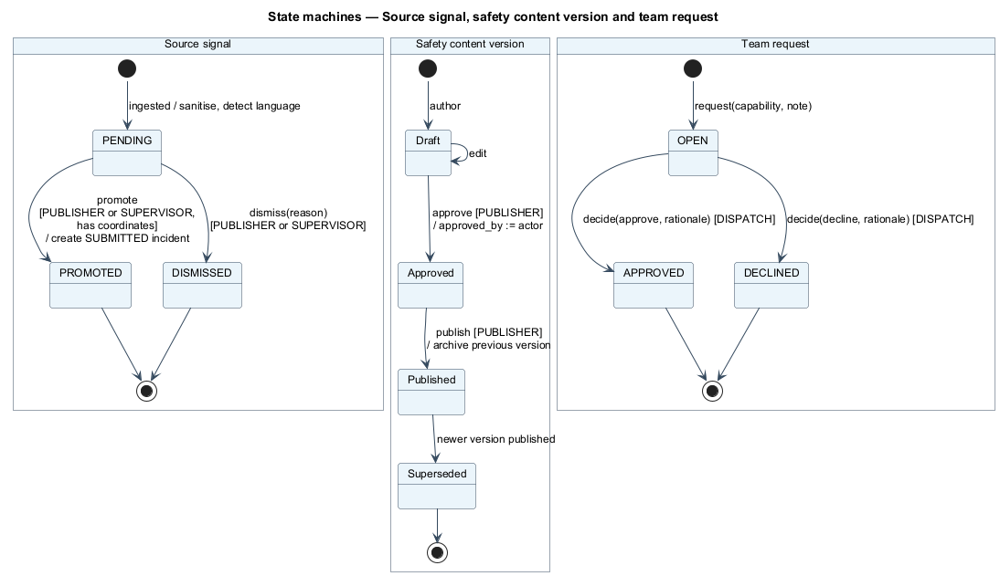

# ResQ: Design Document (UML Diagrams)

Group 30. This document indexes every UML diagram in the submission, explains the notation used, and gives a short reading guide for each diagram. The PlantUML sources are in [`diagrams/`](diagrams/); the rendered images are in [`diagrams/png/`](diagrams/png/).

## 1. Diagram index

| Type | Diagram | Source |
|---|---|---|
| Use case | [Use-case diagram](diagrams/png/use-case.png) | `use-case.puml` |
| Component | [Component diagram](diagrams/png/component.png) | `component.puml` |
| Deployment | [Deployment diagram](diagrams/png/deployment.png) | `deployment.puml` |
| Package | [Backend layering](diagrams/png/object-packages.png) | `object-packages.puml` |
| Class, per sprint | [S0](diagrams/png/sprint0-class.png), [S1](diagrams/png/sprint1-class.png), [S2](diagrams/png/sprint2-class.png), [S3](diagrams/png/sprint3-class.png) | `sprintN-class.puml` |
| Sequence, per sprint | [S0](diagrams/png/sprint0-sequence.png), [S1](diagrams/png/sprint1-sequence.png), [S2](diagrams/png/sprint2-sequence.png), [S3](diagrams/png/sprint3-sequence.png) | `sprintN-sequence.puml` |
| Activity | [Incident response](diagrams/png/activity-incident-response.png), [Ingestion run](diagrams/png/activity-ingestion.png) | `activity-*.puml` |
| State machine | [Incident](diagrams/png/state-incident.png), [Dispatch](diagrams/png/state-dispatch.png), [Donation](diagrams/png/state-donation.png), [Signal, safety content, team request](diagrams/png/state-signal-content.png) | `state-*.puml` |
| Architecture detail (Mermaid) | [Class diagrams](../architecture/class-diagram.md) (entities, services, AI workers) and [sequence diagrams](../architecture/sequence-diagram.md) (ingestion and triage, dispatch and field lifecycle, authentication, incident notes) | `docs/architecture/*.md` |
| Entity–relationship | [er-diagram.md](../architecture/er-diagram.md): generated from the migrations; 35 tables, 56 foreign keys | `scripts/generate_er_diagram.py` |

## 2. Notation and conventions

All diagrams follow **UML 2.5.1** (OMG). PlantUML's `strictuml` style is turned on, so arrowheads and lifelines use UML shapes.

| Convention | How it is applied |
|---|---|
| **Stereotypes (Entity–Control–Boundary)** | `«boundary»` marks HTTP routers and pages. `«control»` marks domain services. `«entity»` marks persistent domain classes (one class per table). `«utility»` marks a module of functions; this is the UML standard-profile stereotype for a class with only static members. `«enumeration»` marks value sets. |
| Attributes and operations | One per line, written `visibility name : Type [multiplicity]`. Visibility is shown as text (`+`, `-`). Abstract classes and abstract operations are in italics. |
| Relationships | Associations carry multiplicities. Composition (filled diamond) is used where the part cannot exist without the whole (for example, status history in an incident). Dependencies are labelled `«use»`, `«create»` or `«import»`. |
| Use cases | Actors are linked to use cases by plain associations, without arrowheads. Shared behaviour is modelled through actor generalization (*Staff member*, *Public visitor*). `«extend»` names the extension point it uses. Authentication is a **precondition**, not an `«include»`. |
| Sequence diagrams | Lifelines are drawn as actor, boundary, control or database. Messages are numbered. Solid arrows are synchronous calls; the open arrowhead marks the asynchronous payment webhook; dashed arrows are replies. Activation bars are shown. Combined fragments are `alt` and `par`, with guards. `==` dividers separate the phases. |
| Activity diagrams | Swimlanes are partitions by actor. Every decision has a guard on each outgoing edge, written `[condition]`. Merges are explicit. Loops use a decision with a back edge. |
| State machines | Transitions are written `trigger [guard] / effect`. Time events use `after(…)`. Internal transitions are listed inside the state. A composite state with a **shallow history** pseudostate (H) models close and reopen. A final state is drawn only where no transition leaves it. |
| Component and deployment | Components expose provided interfaces (lollipop) and required interfaces (socket), plus ports. Nodes are stereotyped `«device»`, `«executionEnvironment»` or `«container»`. Artifacts are deployed inside nodes. Each communication path is labelled with its protocol. |

## 3. Review of the earlier versions

The diagrams first drawn for this submission were reviewed against the conventions above. The table lists what was wrong and how it was fixed; the review notes also make good material for the viva.

| Diagram | Problem in the earlier version | Fix |
|---|---|---|
| Use case | Actor associations had arrowheads | Plain associations |
| Use case | Sign-in modelled as `«include»` of reporting and donating, although guests can donate | Shown as a precondition in a note |
| Use case | Three staff actors each linked to "Sign in"; Citizen and Public visitor were unrelated | Generalization: *Staff member* ← Dispatcher, Field Responder, Administrator; *Public visitor* ← Citizen |
| Use case | `«extend»` without extension points | "Review incident" declares the *AI advice* and *duplicate check* extension points |
| Class | Several attributes on one line; table names used as stereotypes (`«table x»`) and `«module»`, which are not UML | One attribute per line with types and multiplicities; ECB and `«utility»` stereotypes |
| Class | Abstract `TriageProvider` had no abstract operation | `{abstract} triage(payload)` |
| Class | Dependencies unlabelled; visibility shown as icons | Labelled `«use»` / `«create»`; text visibility |
| Sequence | Every participant drawn as a generic box | Actor, boundary, control and database lifelines |
| Sequence | The asynchronous webhook was drawn as a synchronous call | Open-arrowhead asynchronous message |
| Sequence | No message numbers or activation bars; phases not separated | `autonumber`, activations, `==` dividers |
| Activity | The two *optional* reviews were drawn inside a fork, which means both always run in parallel | Two guarded decisions |
| Activity | The information request did not loop back to the review | A loop with guard `[information was requested]` |
| Activity | Rejecting a dispatch was hidden inside "Acknowledge (or reject)" | A separate decision and action in the Field Responder lane |
| Activity | An action text contained `;`, which ended the action early | Split into two actions |
| State | Free-text labels | `trigger [guard] / effect` |
| State | CLOSED was drawn with a final state, although it can be reopened | Composite state *Open* with shallow history (H); CLOSED is not final |
| State | Six separate "close" edges | One transition from the composite state |
| State | Escalation drawn as a self-transition | Internal transition with the time event `after(DISPATCH_ACK_TIMEOUT)` |
| State | Donation expiry not shown as a time event | `after(30 min)`; FAILED shown as not final |
| Component | Boxes with hosting names and no interfaces | A logical component view with ports and provided/required interfaces; hosting moved to the deployment diagram |
| Deployment | No node or artifact stereotypes; unlabelled links | `«device»`, `«executionEnvironment»` and `«container»` nodes; deployed artifacts; protocol on every path |

## 4. Reading guide

### 4.1 Class diagrams

The per-sprint class diagrams show only the classes that sprint introduced or changed. Read them in order:

- **Sprint 0:** identity, audit and the incident core.
- **Sprint 1:** citizen reporting, public map, AI skeleton and the payment interface.
- **Sprint 2:** dispatch, field teams, recommendations, AI integration and ingestion.
- **Sprint 3:** hardened payments, sessions, administration, shelters and notes.

Operation names are written in UML camelCase. They map one-to-one to the Python functions in [06-object-design.md](06-object-design.md); for example, `lockIncident` is `lock_incident`.

### 4.2 Sequence diagrams

| Sprint | Scenario shown |
|---|---|
| 0 | Staff password and TOTP sign-in, then verifying an incident under a row lock and version check |
| 1 | Citizen report with idempotency key and Gujarat geofence, then verification, then the public map with rounded coordinates |
| 2 | Team recommendation, then a dispatch with `SELECT … FOR UPDATE`, then field acknowledgement, progress and completion with resource release |
| 3 | Donation: order, browser verification and the signed webhook in parallel, replay protection, and server-side endings |

### 4.3 Activity diagrams

- **Incident response.** Swimlanes for Citizen, System, Dispatcher and Field Responder. The diagram shows:
  - the validation gate (supported scenario, inside Gujarat);
  - the optional advisory steps (AI triage, duplicate review);
  - the information-request loop;
  - the human decisions at verification, dispatch, backup and closure.

- **Ingestion run.** The advisory lock prevents overlapping runs. The diagram shows the per-adapter loop, how each run is recorded, and the dispatcher's promote-or-dismiss decision. Nothing becomes an incident without that decision.

### 4.4 State machines

- **Incident.** This is `TRANSITIONS` in `services/incidents.py`, inside the composite state *Open*.
  - A citizen's reply to an information request returns the incident to SUBMITTED.
  - *Close* leaves the composite state. It needs the CLOSURE permission; an open dispatch blocks it unless the user gives an override rationale.
  - *Reopen* re-enters through the history state, with the exceptions given in the note.

- **Dispatch.** This is `DISPATCH_TRANSITIONS` in `services/dispatch.py`.
  - Escalation is a time-triggered internal transition of REQUESTED.
  - Terminal states release the reserved resources.

- **Donation.** Three stored states and three failure reasons. FAILED is left only by a late verified capture of the right amount.

- **Signal, safety content and team request** are the smaller lifecycles. The guards show the permission each transition needs.

## 5. Sources

Every image is rendered from the PlantUML file of the same name in [`diagrams/`](diagrams/). The shared style `_style.iuml` uses PlantUML's built-in Smetana layout.
